# LandingZones

**An Azure landing zone you design in a GUI and deploy with Terraform.** A hub & spoke network with a highly available firewall, tier-0 identity in its own subscription and workloads in their own subscriptions, with guardrails from the **Azure Well-Architected Framework**, **NIS2** and **DORA** built into the code.

[](gui/README.md)

<sub>The Landing Zone Designer: pick options on the left, and the scores, cost estimate, pre-flight checks and architecture update on the right.</sub>

## Contents

- [Overview](#overview)
  - [What you get](#what-you-get)
  - [How it fits together](#how-it-fits-together)
  - [Design principles](#design-principles)
- [Architecture](#architecture)
  - [Subscriptions and management groups](#subscriptions-and-management-groups)
  - [Traffic flow](#traffic-flow)
  - [Hub firewall options](#hub-firewall-options)
  - [Tier-0 identity](#tier-0-identity)
  - [Address plan](#address-plan)
  - [What's deployed](#whats-deployed)
- [Landing Zone Designer](#landing-zone-designer)
- [Getting started](#getting-started)
- [Deployment pipeline](#deployment-pipeline)
- [Compliance and guardrails](#compliance-and-guardrails)
- [Third-party firewalls for client subscriptions](#third-party-firewalls-for-client-subscriptions)
- [Reference](#reference)
  - [Run Terraform from a workstation](#run-terraform-from-a-workstation)
  - [Testing and CI](#testing-and-ci)
  - [Key variables](#key-variables)
  - [Repository layout](#repository-layout)
- [Further reading](#further-reading)

---

## Overview

This repository is for platform teams that need a production-grade Azure foundation without hand-editing hundreds of Terraform variables. It has three parts:

| Part | What it is | Who uses it |
|---|---|---|
| **Terraform** (repo root, `modules/`) | The landing zone itself: five subscriptions' worth of networking, firewall, identity, monitoring and governance, with WAF / NIS2 / DORA controls enforced in code | Platform engineers |
| **Landing Zone Designer** (`gui/`) | A Python web app with dropdowns, presets and a live architecture diagram. It validates choices, estimates cost in euro, checks your tenant and writes the Terraform variables | Architects, platform engineers |
| **Deployment pipeline** (`.github/workflows/`, `scripts/`) | Passwordless (OIDC) GitHub Actions: plan on every pull request, apply on `main` after an approval | Everyone who changes the platform |

### What you get

- **Hub & spoke networking.** Every spoke routes `0.0.0.0/0` through the hub firewall, all subnets are private, and Internet egress leaves through a NAT Gateway.
- **A firewall that matches your standards.** Choose the built-in Linux router, **Fortinet FortiGate**, **Palo Alto VM-Series**, **SonicWall NSv** or **Netgate pfSense Plus**. Run it as an active/active pair behind a load balancer, an active/standby pair with Azure API failover, or a single appliance.
- **Tier-0 identity, isolated and redundant.** Domain controllers sit in a dedicated subscription, across two or more regions and two or more zones, each region with an immutable Recovery Services vault.
- **Workloads in their own subscriptions.** Shared services, production and Azure Virtual Desktop each get a landing-zone subscription. Add as many spokes as you need, each with its own NSG rules.
- **Operations built in.** Log Analytics, VNet flow logs with Traffic Analytics, alerts, delete locks, mandatory tags and a monthly budget.
- **Compliance as code.** WAF is always on. Switch on NIS2 and DORA in the designer, and it applies and locks the settings they require.
- **A cost estimate before you deploy**, in euro.
- **Tests that need no Azure credentials.** `terraform test` with mocked providers checks the guardrails on every pull request.

### How it fits together

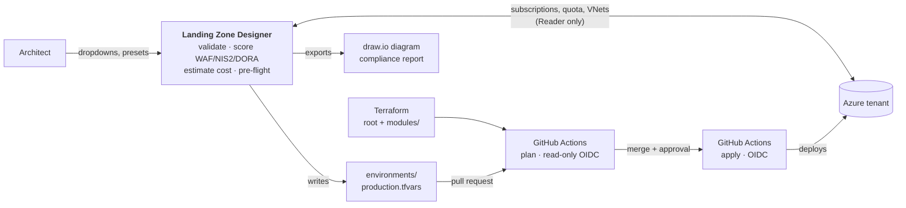

The designer only asks for decisions. The complexity, and every guardrail, lives in the Terraform and in the designer's rules engine, which mirrors the Terraform variable validation.

### Design principles

| Principle | How it shows up |
|---|---|
| **Secure by default** | Private subnets, NSGs with deny-all on every subnet, no public IPs on VMs, Bastion-only admin access, Trusted Launch, Entra ID-only Log Analytics and state |
| **No single point of failure** | Firewalls across Availability Zones, zone-redundant load balancer, Bastion and public IPs; DCs in ≥ 2 regions × ≥ 2 zones |
| **Separation of duties** | Tier-0 identity isolated in its own subscription; read-only plan identity vs approval-gated apply identity |
| **Everything is evidence** | Plans kept 90 days, a compliance report per design, and tests mapped to controls |
| **One source of truth** | The designer writes tfvars; Terraform validates the same rules again, so the GUI is optional |

---

## Architecture

[](docs/architecture.drawio.svg)

<sub>Default design, generated by the designer. `docs/architecture.drawio.svg` embeds the draw.io model: open it in [diagrams.net](https://app.diagrams.net) or VS Code (*Draw.io Integration*), edit and save in place. GitHub keeps rendering it.</sub>

### Subscriptions and management groups

Five subscriptions, following the Azure landing zone pattern:

| Subscription | Contents | Terraform variable |
|---|---|---|
| **Connectivity** | Hub VNet, firewall, Bastion, NAT Gateway, platform monitoring | `subscription_id` |
| **Identity (tier-0)** | Domain controllers in two regions × two zones, a Recovery Services vault per region, tier-0 Key Vault and Log Analytics | `identity_subscription_id` |
| **Shared services** | The `shared` spoke: its own resource group, VNet, NSG and route table, peered to the hub | `shared_services_subscription_id` |
| **Production** | The `prod` spoke, as above | `production_subscription_id` |
| **Azure Virtual Desktop** | The `avd` spoke, as above | `avd_subscription_id` |

Each spoke's `subscription` (`connectivity`, `shared`, `prod` or `avd`) decides where it's deployed. Place the subscriptions in the landing zone management-group hierarchy, so policy, RBAC and cost reporting follow the tiering:

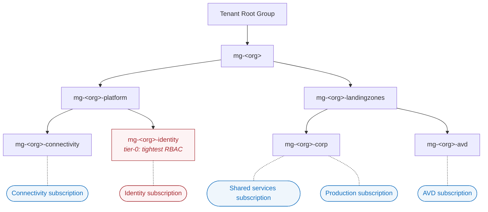

### Traffic flow

Every spoke subnet has a route table that sends `0.0.0.0/0` to the firewall, with BGP route propagation off, so nothing can bypass it. Spoke-to-spoke, spoke-to-Internet and spoke-to-identity traffic is all inspected in the hub. The only way in for administrators is Azure Bastion.

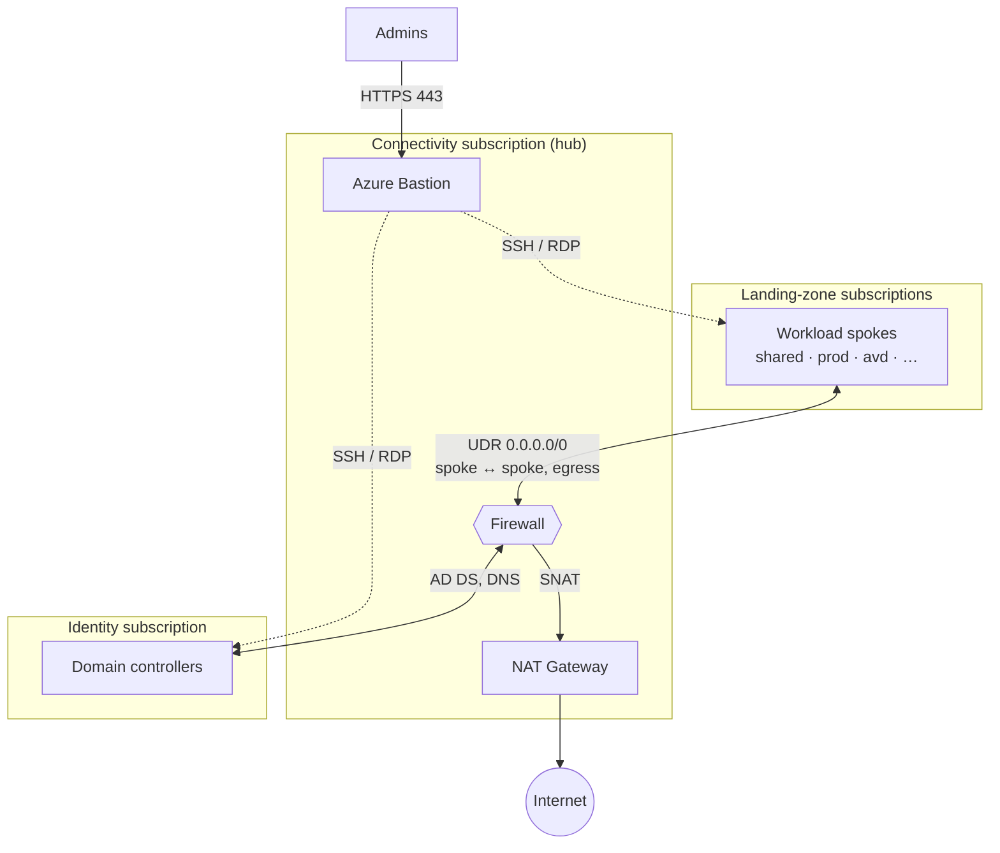

### Hub firewall options

Pick the firewall on the designer's **Firewall** tab, or with `nva_vendor`, `nva_ha_mode` and `nva_license_type`. The rest of the hub (subnets, routing, NSGs, NAT) adapts automatically.

| `nva_vendor` | Appliance | HA modes | Licence |
|---|---|---|---|
| `linux` (default) | Ubuntu 24.04 router with SNAT (cloud-init). Routes, doesn't inspect | active-active | none |
| `fortigate` | Fortinet FortiGate-VM | active-active, active-standby, single | BYOL (FortiFlex / `.lic`) or PAYG |
| `paloalto` | Palo Alto VM-Series | active-active, active-standby, single | BYOL or PAYG bundles |
| `sonicwall` | SonicWall NSv | active-active, active-standby, single | BYOL or PAYG |
| `pfsense` | Netgate pfSense Plus | active-active, single (CARP needs multicast) | PAYG (default) or BYOL |

How each HA mode routes spoke traffic:

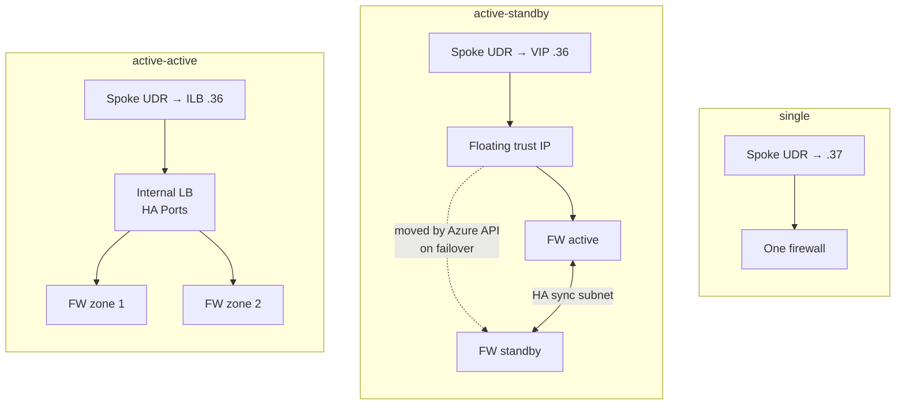

- **Active/active**: firewalls in every zone behind an HA Ports internal load balancer. Highest throughput and the fastest failover (about 10 s).
- **Active/standby**: two firewalls, no load balancer. On failover, the cluster moves the floating trust IP through the Azure API, using a managed identity with a least-privilege custom role. Sessions are synchronised over a dedicated HA sync subnet.
- **Single**: one appliance, for dev/test. Designer control REL-13 flags it as a single point of failure.

Vendor appliances get a generated admin password, stored in a connectivity Key Vault, so the pipeline never handles it.

### Tier-0 identity

Domain controllers are tier-0 assets and live in their own subscription, with their own Key Vault and Log Analytics workspace. They span **two or more regions × two or more zones**, linked by direct mesh peering for AD replication:

| Per region | Shared across regions |
|---|---|
| VNet and DC subnet (AD DS ports open to landing-zone CIDRs only) | Tier-0 Key Vault (premium, RBAC, purge protection): DC admin passwords |
| One Windows Server 2025 DC per zone: static IP, NTDS on a data disk with caching off, Trusted Launch | Tier-0 Log Analytics (365 days, Entra ID only) |
| Recovery Services vault: ZRS or GRS + Cross Region Restore, immutability, soft delete, Enhanced daily policy | Data collection rule: AD DS, DNS, DFSR events |

See **[docs/identity.md](docs/identity.md)** for DC promotion, DNS cutover and the restore runbook.

### Address plan

One base `/16` plans everything; the designer can also switch to manual addressing. Hub subnets, firewall IPs and the next hop are **derived** from `hub_address_space`, so changing it re-addresses everything consistently. Azure reserves the first four IPs of each subnet, which is why the next hop is `.36`.

| VNet | CIDR | Subnet | CIDR | NSG |
|---|---|---|---|---|
| hub | `10.145.0.0/24` | `snet-nva-external` (untrust) | `.0/27` | nva |
| | | `snet-nva-internal` (trust) | `.32/27` | nva |
| | | `snet-mgmt` | `.64/27` | mgmt |
| | | `AzureBastionSubnet` | `.96/27` | bastion (Microsoft rule set) |
| | | `snet-nva-hasync` (active-standby only) | `.128/27` | nva |
| shared (shared services sub) | `10.145.1.0/24` | `snet-shared-app` | `/24` | spoke baseline + your rules |
| prod (production sub) | `10.145.2.0/24` | `snet-prod-app` | `/24` | spoke baseline + your rules |
| avd (AVD sub) | `10.145.3.0/24` | `snet-avd-sessionhosts` | `/24` | spoke baseline + your rules |
| identity primary (identity sub) | `10.145.4.0/24` | `snet-dc` | `/27` | AD DS (landing-zone CIDRs only) |
| identity secondary (identity sub) | `10.146.4.0/24` | `snet-dc` | `/27` | AD DS (landing-zone CIDRs only) |

### What's deployed

| Area | Resources |
|---|---|
| Connectivity | Hub VNet, peerings, NAT Gateway with a static public IP |
| Firewall | The appliance(s) chosen above: one per zone, accelerated networking, an HA Ports ILB (active-active) or failover identity and HA sync subnet (active-standby) |
| Workload spokes | Any number (`spokes` map), each in its chosen subscription (`modules/spoke`): resource group, VNet, NSG with its own rules, route table, peering, flow logs, diagnostics |
| Access | Azure Bastion (zone-redundant, shareable links off) |
| Security | NSGs on every subnet and firewall NIC, optional DDoS plan, optional encryption at host |
| Monitoring | Log Analytics, diagnostics on all network resources, VNet flow logs + Traffic Analytics, Azure Monitor Agent + DCR |
| Alerting | Firewall health and data path, availability and CPU, NAT SNAT failures, DC availability, Service Health, Resource Health |
| Identity (tier-0) | As described above |
| Governance | Mandatory `environment` / `owner` / `cost-center` tags, delete locks, monthly budget |

---

## Landing Zone Designer

`gui/` is a Python ([NiceGUI](https://nicegui.io)) app for anyone who'd rather not edit variables by hand. Every choice redraws the architecture, re-scores the frameworks and updates the cost estimate.

```bash
pip install -r gui/requirements.txt
```

```bash
python gui/app.py
```

Start with `LZDESIGNER_DEMO=1` to try sign-in and pre-flight against a fictional tenant. **[gui/README.md](gui/README.md)** has the full walkthrough.

**1. Start: what needs attention.** A new design lists what's missing, each item linking to the tab that fixes it. Export stays blocked until the list is empty.

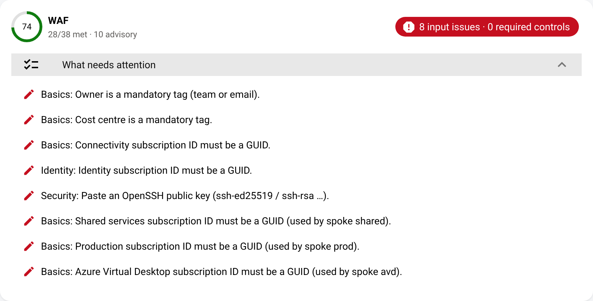

**2. Basics and network.** Sign in to pick the five subscriptions from dropdowns. One `/16` plans every address space; add spokes and choose each one's subscription.

<p>
  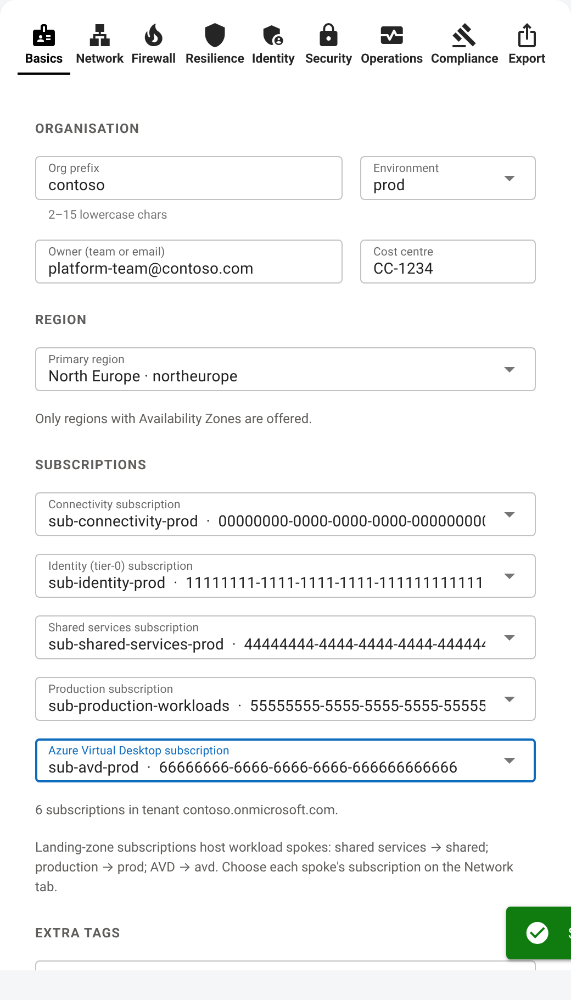
  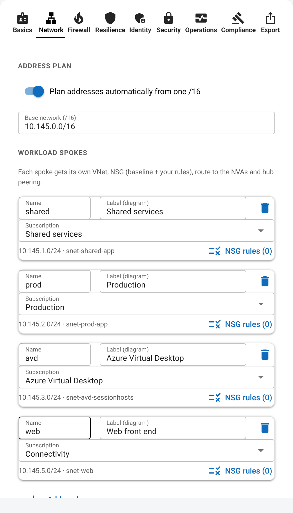
</p>

**3. Firewall.** Vendor, HA mode and licence are dropdowns. Options that don't apply are hidden, and *What you get* explains routing, NICs, management and licensing for the choice.

<p>
  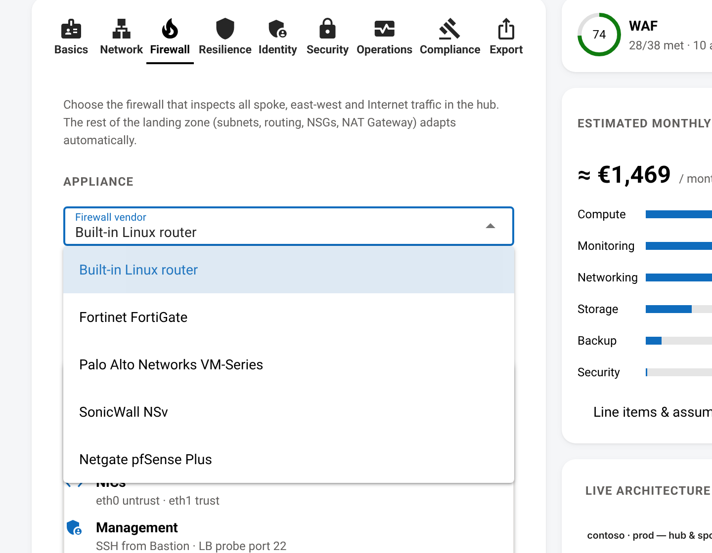
  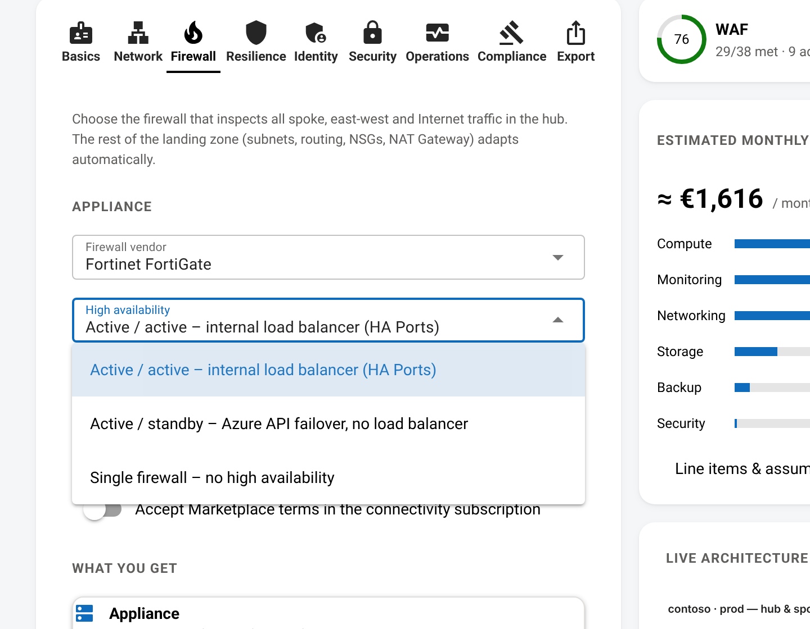
  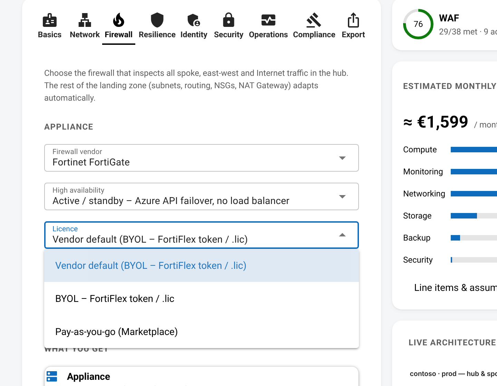
</p>

**4. Compliance.** Switch on NIS2 and DORA, and the settings they require are applied and locked (🔒) on every tab.

<p>
  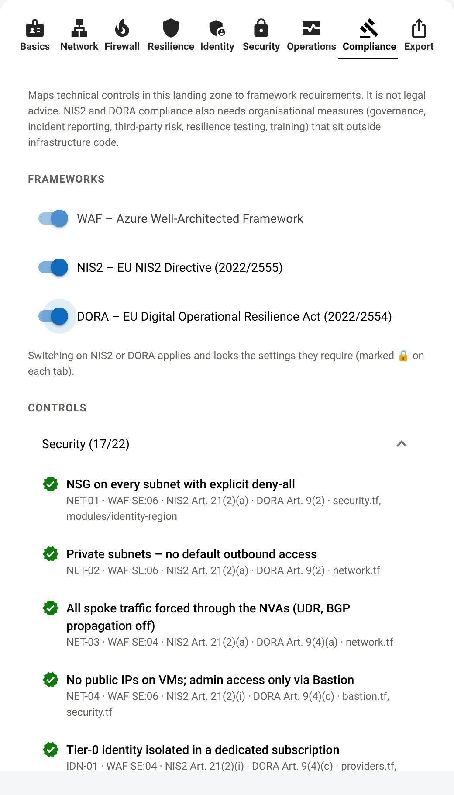
  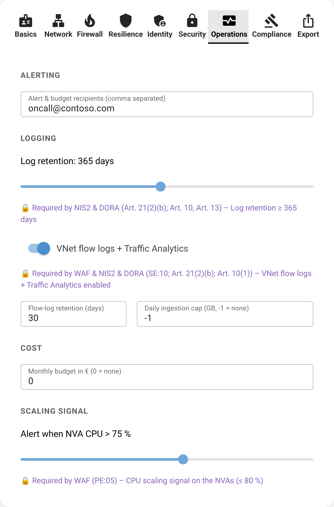
</p>

**5. Cost and pre-flight.** The monthly estimate in euro, and read-only checks against your tenant: subscriptions, permissions, overlapping VNets, Network Watcher, zones, quota and Marketplace terms. Here, pre-flight found an existing VNet that overlaps the `prod` spoke.

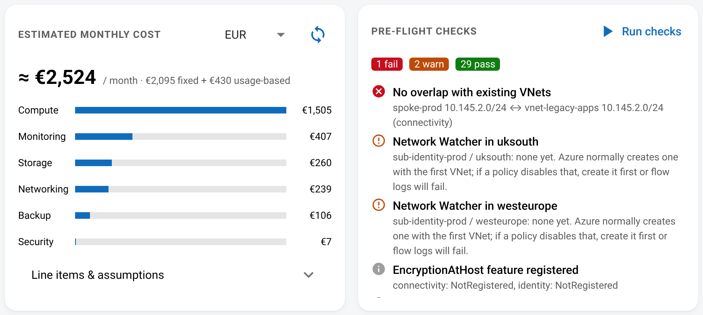

**6. Export and deploy.** Write `terraform.tfvars` or `environments/production.tfvars`, download the draw.io diagram and compliance report, and copy the generated bootstrap command.

<p>
  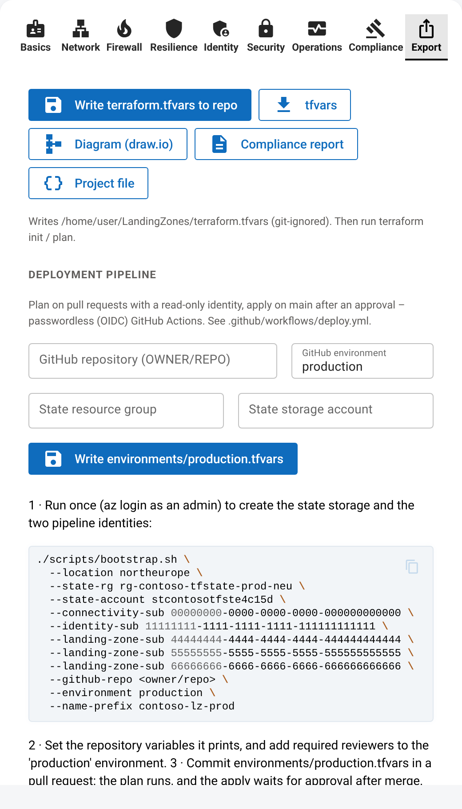
  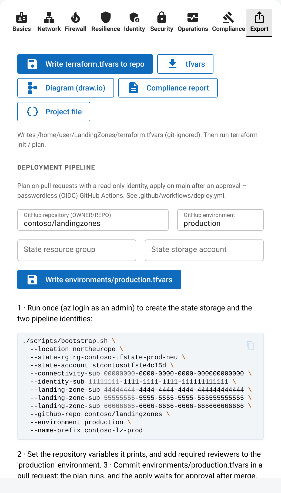
</p>

---

## Getting started

From an empty tenant to a running landing zone. Do the steps in order.

| # | Step | Who | Time |
|---|---|---|---|
| 1 | [Prerequisites](#1-prerequisites) | Platform engineer | 15 min |
| 2 | [Provision the five subscriptions](#2-provision-the-subscriptions) | Billing / tenant admin | 30 min |
| 3 | [Organise them in management groups](#3-organise-the-subscriptions-in-management-groups) | Tenant admin | 10 min |
| 4 | [Register resource providers](#4-register-resource-providers-and-features) | Subscription owner | 10 min |
| 5 | [Design and check in the designer](#5-design-and-pre-flight-in-the-designer) | Platform engineer | 30 min |
| 6 | [Bootstrap Terraform state and the pipeline identities](#6-bootstrap-state-and-the-pipeline) | Subscription owner | 10 min |
| 7 | [Configure GitHub](#7-configure-github) | Repo admin | 10 min |
| 8 | [First deployment](#8-first-deployment) | Platform engineer + approver | 45 min |
| 9 | [Post-deployment](#9-post-deployment) | Platform + identity team | ½ day |

### 1. Prerequisites

- **Tools:**
  - Terraform ≥ 1.9.
  - Azure CLI ≥ 2.60. Run `az extension add --name account` for subscription creation.
  - Python 3.11+ (for the designer).
  - Git, and a GitHub repository holding this code.
- **Entra ID roles** for whoever runs the setup:
  - **Application Administrator**, or permission to create app registrations (pipeline identities).
  - **Owner** on the subscriptions once they exist.
  - The **billing role** that lets you create subscriptions:
    - EA: *Enrollment account owner*.
    - MCA: *Owner* or *Azure subscription creator* on an invoice section.
- **Decisions to make first:**
  - Primary and secondary regions (both must support Availability Zones).
  - An address range that doesn't overlap on-premises or existing VNets (default `10.145.0.0/16` + `10.146.0.0/16`).
  - The org prefix and environment name.
  - The hub firewall vendor and, for BYOL, the licences.
  - The on-call email for alerts.
  - A monthly budget in EUR.

### 2. Provision the subscriptions

Create the **five** subscriptions from the [subscriptions table](#subscriptions-and-management-groups) in the same tenant. Suggested names: `sub-<org>-connectivity-prod`, `sub-<org>-identity-prod`, `sub-<org>-shared-services-prod`, `sub-<org>-production-prod` and `sub-<org>-avd-prod`.

You can create them in the portal (*Subscriptions → Add*) or from the CLI with a **subscription alias**. Look up your billing scope first:

```bash
az billing account list --query "[].{name:name, displayName:displayName, agreementType:agreementType}" -o table
```

- **EA:** the scope is `/providers/Microsoft.Billing/billingAccounts/<billingAccount>/enrollmentAccounts/<enrollmentAccount>`.
- **MCA:** the scope is `/providers/Microsoft.Billing/billingAccounts/<billingAccount>/billingProfiles/<billingProfile>/invoiceSections/<invoiceSection>`.

Then create each subscription (repeat with each name):

```bash
az account alias create --name sub-contoso-connectivity-prod --display-name sub-contoso-connectivity-prod --billing-scope "<billing-scope>" --workload Production
```

Collect the five subscription IDs. You'll pick them from a dropdown in the designer, or paste them into `environments/production.tfvars`:

```bash
az account list --query "[?starts_with(name, 'sub-contoso')].{name:name, id:id}" -o table
```

> Pay-as-you-go or CSP tenants can't create subscriptions from the CLI. Create them in the portal or partner centre, then continue.

### 3. Organise the subscriptions in management groups

Build the [hierarchy shown above](#subscriptions-and-management-groups). Create each management group from the top down:

```bash
az account management-group create --name mg-contoso-platform --display-name "Platform" --parent mg-contoso
```

Then move each subscription into its group:

```bash
az account management-group subscription add --name mg-contoso-identity --subscription <identity-subscription-id>
```

Only tier-0 admins should get RBAC on `mg-<org>-identity`. Use PIM for eligible, time-bound access where you have Entra ID P2.

### 4. Register resource providers and features

Register these resource providers in **every** subscription. It's idempotent and quick.

```bash
for sub in <connectivity-id> <identity-id> <shared-id> <prod-id> <avd-id>; do for ns in Microsoft.Network Microsoft.Compute Microsoft.Storage Microsoft.KeyVault Microsoft.RecoveryServices Microsoft.OperationalInsights Microsoft.Insights Microsoft.ManagedIdentity Microsoft.Authorization Microsoft.MarketplaceOrdering; do az provider register --subscription "$sub" --namespace "$ns"; done; done
```

Optional, only if you'll turn on *encryption at host*. Register it on the connectivity and identity subscriptions:

```bash
az feature register --subscription <subscription-id> --namespace Microsoft.Compute --name EncryptionAtHost
```

### 5. Design and pre-flight in the designer

Start the [designer](#landing-zone-designer), then:

1. **Sign in to Azure** (top right) with your `az login` session.
2. On **Basics**, pick the five subscriptions, and set the org prefix, owner and cost centre.
3. Choose the hub **firewall** on the Firewall tab. Adjust the network, spokes, resilience and identity regions. Switch on **NIS2 / DORA** if they apply to you.
4. Press **Run checks**. Fix every red item: overlapping VNets, quota, missing permissions, zones, Marketplace terms.
5. Check the **estimated monthly cost**.

### 6. Bootstrap state and the pipeline

On the designer's **Export** tab, enter the GitHub repository and environment, then copy the generated `scripts/bootstrap.sh` command. Run it once as a subscription owner, with `--dry-run` first:

```bash
./scripts/bootstrap.sh --dry-run --location northeurope --state-rg rg-contoso-tfstate-prod-neu --state-account stcontosotfstate01 --connectivity-sub <guid> --identity-sub <guid> --landing-zone-sub <shared-guid> --landing-zone-sub <prod-guid> --landing-zone-sub <avd-guid> --github-repo OWNER/REPO --environment production
```

It creates:

- **The Terraform state storage:** ZRS, Entra ID auth only, versioning, soft delete and a delete lock.
- **Two pipeline identities with OIDC federation, so no secrets are stored:** `-plan` (read-only) and `-apply` (Contributor + User Access Administrator on all five subscriptions).

### 7. Configure GitHub

1. **Repository variables:** add the ones the bootstrap script prints (*Settings → Secrets and variables → Actions → Variables*): `AZURE_TENANT_ID`, `AZURE_PLAN_CLIENT_ID`, `AZURE_APPLY_CLIENT_ID`, `CONNECTIVITY_SUBSCRIPTION_ID`, `TFSTATE_*` and `TF_ENVIRONMENT`.
2. **Approval gate:** create the **environment** named in `TF_ENVIRONMENT` (default `production`) and add **required reviewers** (*Settings → Environments*).
3. **Branch protection:** protect `main` and require the `fmt / validate / test / lint` check before merging.

### 8. First deployment

1. In the designer, **Export → Write environments/production.tfvars**.
2. Commit it on a branch and open a pull request. The **plan** job posts the plan to the run summary.
3. Review the plan, and merge.
4. An approver approves the **apply**. The landing zone deploys in about 30–45 minutes, mostly Bastion and the DCs.

See the [deployment pipeline](#deployment-pipeline) for how this works, or [run Terraform from a workstation](#run-terraform-from-a-workstation) instead.

### 9. Post-deployment

- **Identity:** promote the domain controllers, create AD sites and cut DNS over, following [docs/identity.md](docs/identity.md). Then set `identity_dns_servers` and re-apply. Lock the vault immutability once retention is final.
- **Firewall:** licence and configure vendor appliances (the admin password is in the connectivity Key Vault). For active-standby, test a failover and check that the trust VIP moves.
- **Networking:** confirm spoke egress goes through the firewall. Run a zone failover drill: stop one firewall and check that traffic continues and the alert fires.
- **Security:** deploy Defender for Identity on the DCs, enable Defender for Cloud plans and assign the Azure landing zone policies at `mg-<org>`.
- **Operations:** confirm alert emails arrive, and compare the first month's actual cost with the designer estimate.

---

## Deployment pipeline

`.github/workflows/deploy.yml` deploys with GitHub Actions and **OIDC, so there are no stored secrets**, using two identities for separation of duties:

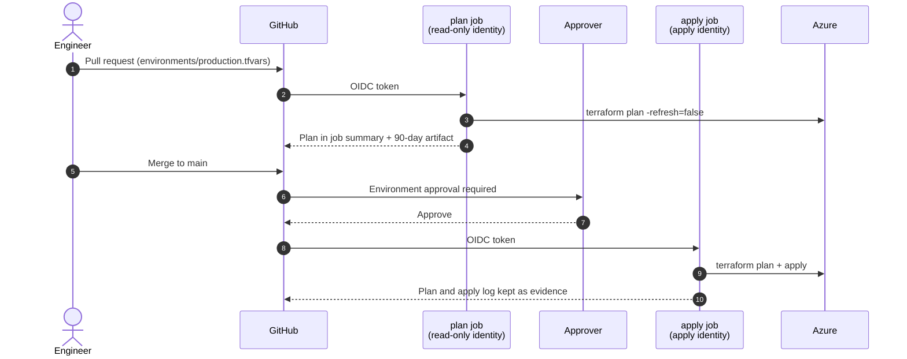

| Trigger | Identity | Rights | What runs |
|---|---|---|---|
| Pull request | `<prefix>-plan` | Reader on every subscription, state read/lock | `terraform plan -refresh=false` → job summary + 90-day artifact |
| Merge to `main` | `<prefix>-apply` | Contributor + User Access Administrator on every subscription | waits for **required reviewers**, then full plan → apply |

PR plans skip refresh, so the read-only identity never reads tier-0 Key Vault secrets. The plan text of every run is kept as evidence of the change (DORA Art. 9(4)(e)). The workflow stays inactive until the repository variables exist. Set it up with [steps 6–8](#6-bootstrap-state-and-the-pipeline).

---

## Compliance and guardrails

Controls are enforced in three layers, so a bad setting is caught as early as possible:

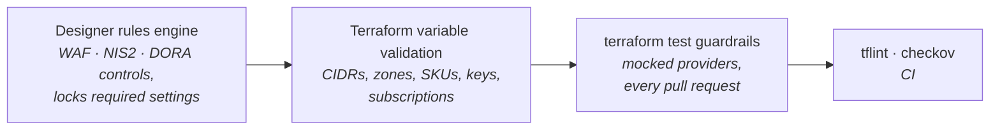

| Framework | Coverage |
|---|---|
| **Azure Well-Architected** | Always on. Every pillar is mapped control by control in **[docs/well-architected.md](docs/well-architected.md)**, including accepted trade-offs |
| **NIS2** (Directive (EU) 2022/2555) | Art. 21(2)(a)–(j) risk-management measures and Art. 23 reporting: e.g. alert recipients, logging and retention, network segmentation, backup |
| **DORA** (Regulation (EU) 2022/2554) | Art. 9 protection, 10 detection, 11 response and recovery, 12 backup (geo-redundant with Cross Region Restore), 17 incident management |

Switching a framework on in the designer applies and locks the settings it requires, and shows the article that requires each one. *Export → Compliance report* produces the evidence for an auditor.

> This maps technical controls to framework requirements. It is not legal advice. NIS2 and DORA also need organisational measures (governance, incident reporting, third-party risk, resilience testing, training) that sit outside infrastructure code.

---

## Third-party firewalls for client subscriptions

`modules/nva-firewall` deploys **FortiGate, SonicWall NSv, Palo Alto VM-Series or pfSense Plus** into a *client's* subscription, separately from this landing zone. It supports `single`, `active-standby` (Azure API failover) and `active-active` (internal + external Standard LBs). The hub firewall above is built from the same modules.

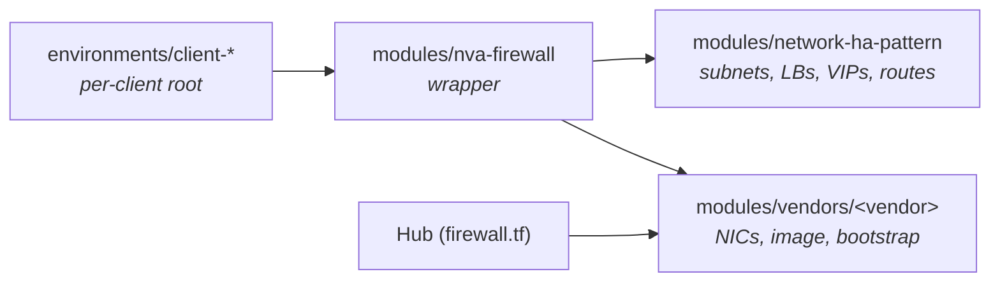

Worked examples: `client-a-sonicwall-single`, `client-b-pfsense-active-active` and `client-c-fortinet-active-standby` in [environments/](environments/README.md). See **[modules/nva-firewall/README.md](modules/nva-firewall/README.md)**.

---

## Reference

### Run Terraform from a workstation

The deploying identity needs Owner (or Contributor + User Access Administrator) on all five subscriptions, because it peers across them and grants itself Key Vault Secrets Officer on the tier-0 vault.

```bash
cp terraform.tfvars.example terraform.tfvars   # or write it from the designer
```

```bash
export ARM_SUBSCRIPTION_ID=<connectivity-subscription-id>
```

```bash
terraform init
```

```bash
terraform plan -out tfplan
```

```bash
terraform apply tfplan
```

To tear down, set `enable_resource_locks = false` and apply before running `terraform destroy`.

### Testing and CI

`.github/workflows/terraform.yml` runs on every pull request:

| Check | What it covers |
|---|---|
| `terraform fmt` / `validate` | Root, modules and client environments |
| `terraform test` (root) | WAF and tier-0 guardrails against mocked providers: addressing, zones, NSG coverage, private subnets, Trusted Launch, flow logs, diagnostics, tags, budget, naming, identity redundancy, NTDS disk caching, backup policy, firewall vendors and HA modes |
| `terraform test` (modules, clients) | The firewall framework for every vendor × HA mode, and the three client examples |
| `pytest gui/tests` | Designer validation, compliance, pricing, pre-flight against a fake tenant, the bootstrap script, and plans of generated tfvars |
| `tflint`, `checkov` | azurerm ruleset and security scanning |

```bash
terraform test
```

```bash
python -m pytest gui/tests -q
```

### Key variables

<details>
<summary>Show the most important variables. <code>variables.tf</code> has the full list, all with validation and descriptions.</summary>

| Variable | Default | Notes |
|---|---|---|
| `org_prefix` | — | **Required.** 2–15 lowercase chars. |
| `owner`, `cost_center` | — | **Required.** Mandatory tags. |
| `environment` | `prod` | Used in names and tags. |
| `location` | `northeurope` | Must support Availability Zones. |
| `subscription_id` | `null` | Connectivity subscription. Falls back to `ARM_SUBSCRIPTION_ID`. |
| `identity_subscription_id` | — | **Required.** Dedicated tier-0 subscription. |
| `shared_services_subscription_id` / `production_subscription_id` / `avd_subscription_id` | — | **Required** when a spoke targets them. Must differ from each other, connectivity and identity. |
| `spokes` | shared / prod / avd (`10.145.1-3.0/24`) | Map of workload spokes: `address_space`, `subscription` (`connectivity` / `shared` / `prod` / `avd`), optional `subnet_name`, optional `nsg_rules` (priority 300–3900, no Internet inbound). |
| `nva_vendor` / `nva_ha_mode` / `nva_license_type` | `linux` / `active-active` / vendor default | Hub firewall: `linux`, `fortigate`, `paloalto`, `sonicwall`, `pfsense`. Vendors support `active-active`, `active-standby` (not pfSense) and `single`, and need `nva_size` ≥ 4 vCPUs. |
| `nva_accept_marketplace_terms` | `false` | Accept the vendor image's Marketplace terms in the connectivity subscription. Vendor bootstrap inputs (`nva_fortigate_license_tokens`, `nva_paloalto_bootstrap`, …) go in tfvars or `TF_VAR_*`. |
| `nva_admin_ssh_public_key` | — | **Required.** |
| `nva_zones` | `["1","2"]` | One firewall per zone in active-active; add zones to scale out. |
| `nva_size` | `Standard_D2s_v5` | |
| `zones` | `["1","2","3"]` | Zone-redundant ILB, Bastion, public IPs. |
| `identity_regions` | neu `10.145.4.0/24` + weu `10.146.4.0/24`, zones 1–2 | ≥ 2 regions, ≥ 2 zones each. |
| `dc_size` / `dc_image_sku` | `Standard_D2s_v5` / `2025-datacenter-azure-edition` | |
| `identity_backup_storage_mode` | `ZoneRedundant` | `GeoRedundant` adds Cross Region Restore. |
| `identity_dns_servers` | `[]` | Set to `identity_dc_ips` after promotion. |
| `identity_allow_hub_bastion` / `identity_admin_source_cidrs` | `true` / `[]` | Who may RDP to DCs. |
| `identity_key_vault_allowed_ips` | `[]` | Restrict the tier-0 Key Vault firewall. |
| `alert_email_addresses` | `[]` | Action group + budget recipients. |
| `monthly_budget_amount` | `0` | 0 disables the budget. |
| `enable_flow_logs` | `true` | Needs the region's Network Watcher. |
| `enable_nat_gateway` | `true` | |
| `enable_resource_locks` | `true` | |
| `bastion_sku` | `Standard` | `Basic` to save cost. |
| `ddos_protection_plan_id` | `null` | Attach an existing DDoS plan. |
| `nva_encryption_at_host` | `false` | Requires a subscription feature. |
| `log_retention_days` / `log_daily_quota_gb` | `90` / `-1` | |

</details>

### Repository layout

<details>
<summary>Show the repository layout.</summary>

| Path | Contents |
|---|---|
| `providers.tf` | Terraform/provider versions, provider per subscription, optional backend |
| `variables.tf` | Inputs with validation, grouped by WAF pillar |
| `locals.tf` | CAF naming, tags, derived addressing, spoke and firewall maps |
| `main.tf` | Resource groups, Log Analytics, delete locks |
| `network.tf` | Hub VNet, subnets, peerings, route tables, NAT Gateway, spoke modules |
| `security.tf` | NSGs and associations |
| `nva.tf` | Built-in Linux firewall: ILB, NICs, VMs, Azure Monitor Agent |
| `firewall.tf` | Vendor firewall in the hub: vendor module, HA sync subnet, failover identity, admin password Key Vault |
| `bastion.tf` | Azure Bastion |
| `monitoring.tf` | Diagnostics, flow logs, DCR, action group, alerts |
| `cost.tf` | Budget |
| `identity.tf` | Tier-0 shared services, identity modules, peerings, DC alerts |
| `outputs.tf` | Outputs |
| `modules/spoke/` | One workload spoke in its landing-zone subscription |
| `modules/identity-region/` | Per-region identity: VNet, NSG, DCs, NTDS disks, Recovery Services vault, flow logs |
| `modules/nva-firewall/`, `modules/network-ha-pattern/`, `modules/vendors/` | Third-party firewall framework (FortiGate, SonicWall, Palo Alto, pfSense) |
| `environments/` | Per-environment tfvars for the deploy workflow, and the client firewall examples |
| `scripts/bootstrap.sh` | One-off: state storage + OIDC plan/apply identities |
| `.github/workflows/` | `terraform.yml` (CI checks), `deploy.yml` (plan on PR, approval-gated apply) |
| `tests/` | `terraform test` guardrails |
| `gui/` | Landing Zone Designer: GUI, compliance rules engine, live diagram, pricing, pre-flight, tfvars generator |
| `docs/` | Architecture diagram, WAF mapping, identity runbook, screenshots |

</details>

---

## Further reading

- **[gui/README.md](gui/README.md)**: the designer, screen by screen, and how its guardrails work.
- **[docs/well-architected.md](docs/well-architected.md)**: WAF alignment pillar by pillar, trade-offs and gaps.
- **[docs/identity.md](docs/identity.md)**: tier-0 identity design, backup, DC promotion and restore runbook.
- **[modules/nva-firewall/README.md](modules/nva-firewall/README.md)**: the third-party firewall framework.
- **[environments/README.md](environments/README.md)**: per-environment and per-client roots.
