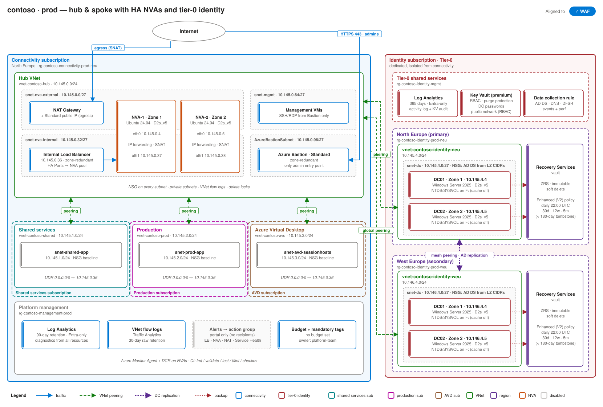
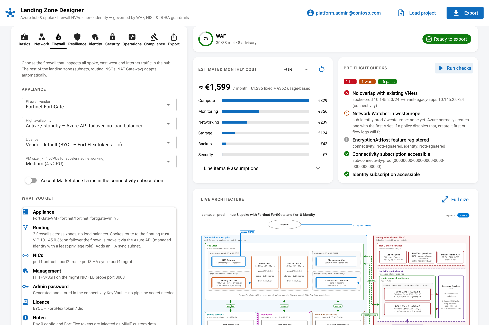

# LandingZones

Terraform for an Azure **hub & spoke** network with a **highly available NVA pair** behind an internal Standard Load Balancer (HA Ports), aligned to the **Azure Well-Architected Framework** and Cloud Adoption Framework naming.

➡️ **[Well-Architected alignment, pillar by pillar](docs/well-architected.md)** · **[Identity (tier-0) design & runbook](docs/identity.md)**

Five subscriptions, following the Azure landing zone pattern:

| Subscription | Contents |
|---|---|
| Connectivity | Hub, HA NVAs, Bastion, NAT Gateway, platform monitoring (and any spoke you explicitly keep there) |
| Identity (tier-0) | Domain controllers in two regions × two zones, a Recovery Services vault per region, tier-0 Key Vault and Log Analytics |
| Shared services (landing zone) | The `shared` spoke: its own resource group, VNet, NSG and route table, peered to the hub |
| Production (landing zone) | The `prod` spoke, as above |
| Azure Virtual Desktop (landing zone) | The `avd` spoke, as above |

Each spoke's `subscription` (`connectivity`, `shared`, `prod` or `avd`) decides where it's deployed.

---

## Getting started

From an empty tenant to a running landing zone. Do the steps in order; each one links to the detail further down.

| # | Step | Who | Time |
|---|---|---|---|
| 1 | [Prerequisites](#1-prerequisites) | Platform engineer | 15 min |
| 2 | [Provision the five subscriptions](#2-provision-the-subscriptions) | Billing / tenant admin | 30 min |
| 3 | [Organise them in management groups](#3-organise-the-subscriptions-in-management-groups) | Tenant admin | 10 min |
| 4 | [Register resource providers](#4-register-resource-providers-and-features) | Subscription owner | 10 min |
| 5 | [Design and check in the Landing Zone Designer](#5-design-and-pre-flight-in-the-designer) | Platform engineer | 30 min |
| 6 | [Bootstrap Terraform state and the pipeline identities](#6-bootstrap-state-and-the-pipeline) | Subscription owner | 10 min |
| 7 | [Configure GitHub](#7-configure-github) | Repo admin | 10 min |
| 8 | [First deployment](#8-first-deployment) | Platform engineer + approver | 45 min |
| 9 | [Post-deployment](#9-post-deployment) | Platform + identity team | ½ day |

### 1. Prerequisites

- **Tools:**
  - Terraform ≥ 1.9.
  - Azure CLI ≥ 2.60. Run `az extension add --name account` for subscription creation.
  - Python 3.11+ (for the designer).
  - Git, and a GitHub repository holding this code.
- **Entra ID roles** for whoever runs the setup:
  - **Application Administrator**, or permission to create app registrations (pipeline identities).
  - **Owner** on the subscriptions once they exist.
  - The **billing role** that lets you create subscriptions:
    - EA: *Enrollment account owner*.
    - MCA: *Owner* or *Azure subscription creator* on an invoice section.
- **Decisions to make first:**
  - Primary and secondary regions (both must support Availability Zones).
  - An address range that doesn't overlap on-premises or existing VNets (default `10.145.0.0/16` + `10.146.0.0/16`).
  - The org prefix and environment name.
  - The on-call email for alerts.
  - A monthly budget in EUR.

### 2. Provision the subscriptions

Create **five** subscriptions in the same tenant:

| Subscription | Suggested name | Terraform variable |
|---|---|---|
| Connectivity | `sub-<org>-connectivity-prod` | `subscription_id` |
| Identity (tier-0) | `sub-<org>-identity-prod` | `identity_subscription_id` |
| Shared services | `sub-<org>-shared-services-prod` | `shared_services_subscription_id` |
| Production | `sub-<org>-production-prod` | `production_subscription_id` |
| Azure Virtual Desktop | `sub-<org>-avd-prod` | `avd_subscription_id` |

You can create them in the portal (*Subscriptions → Add*) or from the CLI with a **subscription alias**. Look up your billing scope first:

```bash
az billing account list --query "[].{name:name, displayName:displayName, agreementType:agreementType}" -o table
```

- **EA:** the scope is `/providers/Microsoft.Billing/billingAccounts/<billingAccount>/enrollmentAccounts/<enrollmentAccount>`.
- **MCA:** the scope is `/providers/Microsoft.Billing/billingAccounts/<billingAccount>/billingProfiles/<billingProfile>/invoiceSections/<invoiceSection>`.

Then create each subscription (repeat with each name from the table):

```bash
az account alias create --name sub-contoso-connectivity-prod --display-name sub-contoso-connectivity-prod --billing-scope "<billing-scope>" --workload Production
```

Collect the five subscription IDs. You'll pick them from a dropdown in the designer, or paste them into `environments/production.tfvars`:

```bash
az account list --query "[?starts_with(name, 'sub-contoso')].{name:name, id:id}" -o table
```

> Pay-as-you-go or CSP tenants can't create subscriptions from the CLI. Create them in the portal or partner centre, then continue.

### 3. Organise the subscriptions in management groups

Use the Azure landing zone hierarchy, so policy, RBAC and cost reporting follow the tiering:

```
Tenant Root Group
└── mg-<org>
    ├── mg-<org>-platform
    │   ├── mg-<org>-connectivity   ← connectivity subscription
    │   └── mg-<org>-identity       ← identity subscription (tier-0: tightest RBAC)
    └── mg-<org>-landingzones
        ├── mg-<org>-corp           ← shared services, production
        └── mg-<org>-avd            ← AVD
```

Create each management group, from the top down:

```bash
az account management-group create --name mg-contoso-platform --display-name "Platform" --parent mg-contoso
```

Then move each subscription into its group:

```bash
az account management-group subscription add --name mg-contoso-identity --subscription <identity-subscription-id>
```

Only tier-0 admins should get RBAC on `mg-<org>-identity`. Use PIM for eligible, time-bound access where you have Entra ID P2.

### 4. Register resource providers and features

Register these resource providers in **every** subscription. It's idempotent and quick.

```bash
for sub in <connectivity-id> <identity-id> <shared-id> <prod-id> <avd-id>; do for ns in Microsoft.Network Microsoft.Compute Microsoft.Storage Microsoft.KeyVault Microsoft.RecoveryServices Microsoft.OperationalInsights Microsoft.Insights Microsoft.ManagedIdentity Microsoft.Authorization Microsoft.MarketplaceOrdering; do az provider register --subscription "$sub" --namespace "$ns"; done; done
```

Optional, only if you'll turn on *encryption at host*. Register it on the connectivity and identity subscriptions:

```bash
az feature register --subscription <subscription-id> --namespace Microsoft.Compute --name EncryptionAtHost
```

Also check that each subscription has enough **vCPU quota** for the default design: 2 × D2s_v5 NVAs plus 2 × D2s_v5 DCs per region. The designer's pre-flight checks this in the next step.

### 5. Design and pre-flight in the designer

```bash
pip install -r gui/requirements.txt
```

```bash
python gui/app.py
```

1. **Sign in to Azure** (top right) with your `az login` session.
2. On **Basics**, pick the five subscriptions from the dropdowns, and set the org prefix, owner and cost centre.
3. Adjust the network, resilience, identity regions and spokes. Switch on **NIS2 / DORA** if they apply to you.
4. Press **Run checks** (pre-flight). Fix every red item: overlapping VNets, quota, missing permissions, zones.
5. Check the **estimated monthly cost** (EUR).

See [gui/README.md](gui/README.md) for a screen-by-screen walkthrough.

### 6. Bootstrap state and the pipeline

On the designer's **Export** tab, enter the GitHub repository and environment name, then copy the generated `scripts/bootstrap.sh` command. Run it once as a subscription owner, with `--dry-run` first:

```bash
./scripts/bootstrap.sh --dry-run --location northeurope --state-rg rg-contoso-tfstate-prod-neu --state-account stcontosotfstate01 --connectivity-sub <guid> --identity-sub <guid> --landing-zone-sub <shared-guid> --landing-zone-sub <prod-guid> --landing-zone-sub <avd-guid> --github-repo OWNER/REPO --environment production
```

It creates two things:

- **The Terraform state storage:** ZRS, Entra ID auth only, versioning, soft delete and a delete lock.
- **Two pipeline identities with OIDC federation, so no secrets are stored:**
  - `-plan` is read-only.
  - `-apply` gets Contributor + User Access Administrator on all five subscriptions.

### 7. Configure GitHub

1. **Repository variables:** add the ones the bootstrap script prints (*Settings → Secrets and variables → Actions → Variables*):
   - `AZURE_TENANT_ID`, `AZURE_PLAN_CLIENT_ID`, `AZURE_APPLY_CLIENT_ID`;
   - `CONNECTIVITY_SUBSCRIPTION_ID`;
   - `TFSTATE_*`, `TF_ENVIRONMENT`.
2. **Approval gate:** create the **environment** named in `TF_ENVIRONMENT` (default `production`) and add **required reviewers** (*Settings → Environments*). Every apply waits for them.
3. **Branch protection:** protect `main` and require the `fmt / validate / test / lint` check before merging.

### 8. First deployment

1. In the designer, **Export → Write environments/production.tfvars**.
2. Commit it on a branch and open a pull request. The **plan** job posts the plan to the run summary.
3. Review the plan, and merge.
4. An approver approves the **apply** in GitHub Actions. The landing zone deploys (about 30–45 minutes, mostly Bastion and the DCs).

You can also run it from a workstation instead (see [Usage](#usage)): `terraform init`, then `plan` and `apply` with `-var-file=environments/production.tfvars`.

### 9. Post-deployment

- **Identity:**
  - Promote the domain controllers, create AD sites and cut DNS over. Follow [docs/identity.md](docs/identity.md).
  - Then set `identity_dns_servers` and re-apply.
  - Lock the vault immutability once retention is final.
- **Networking:**
  - Confirm spoke egress goes through the NVAs.
  - Run a zone failover drill: stop one NVA and check that traffic continues and the alert fires.
- **Security:**
  - Deploy Defender for Identity on the DCs.
  - Enable Defender for Cloud plans.
  - Assign the Azure landing zone policies at `mg-<org>`.
- **Operations:**
  - Confirm alert emails arrive.
  - Check the budget and the first month's actual cost against the designer estimate.
- **Third-party firewalls** (instead of, or alongside, the Linux NVAs): onboard per client with [modules/nva-firewall](modules/nva-firewall/README.md).

---

## Architecture

[](docs/architecture.drawio.svg)

> **Editing the diagram:** `docs/architecture.drawio.svg` is an SVG with the draw.io model embedded. Open it in [diagrams.net](https://app.diagrams.net) (*File → Open from → Device*) or in VS Code with the *Draw.io Integration* extension, edit, and save it in place. GitHub keeps rendering the updated SVG, so there's no separate export step.

Every spoke subnet has a UDR sending `0.0.0.0/0` to the ILB frontend, so spoke↔spoke and spoke→Internet traffic always goes through the NVAs. All workload subnets are private (no default outbound access).

### Address plan (defaults)

Hub subnets, NVA IPs and the ILB frontend are **derived** from `hub_address_space`, so changing the variable re-addresses everything consistently. Azure reserves the first four IPs of each subnet, which is why the ILB uses `.36`.

| VNet | CIDR | Subnet | CIDR | NSG |
|---|---|---|---|---|
| hub | `10.145.0.0/24` | `snet-nva-external` | `.0/27` | nva |
| | | `snet-nva-internal` | `.32/27` | nva |
| | | `snet-mgmt` | `.64/27` | mgmt |
| | | `AzureBastionSubnet` | `.96/27` | bastion (Microsoft rule set) |
| shared (shared-services sub) | `10.145.1.0/24` | `snet-shared-app` | `/24` | spoke baseline |
| prod (production sub) | `10.145.2.0/24` | `snet-prod-app` | `/24` | spoke baseline |
| avd (AVD sub) | `10.145.3.0/24` | `snet-avd-sessionhosts` | `/24` | spoke baseline |
| identity (primary, identity sub) | `10.145.4.0/24` | `snet-dc` | `/27` | AD DS (landing-zone CIDRs only) |
| identity (secondary, identity sub) | `10.146.4.0/24` | `snet-dc` | `/27` | AD DS (landing-zone CIDRs only) |

### What's deployed

| Area | Resources |
|---|---|
| Connectivity | Hub, peerings, NAT Gateway |
| Workload spokes | Any number (`spokes` map), each in its chosen subscription (`modules/spoke`): resource group, VNet, NSG with its own rules, route table to the NVAs, flow logs, diagnostics |
| NVA | 2+ Ubuntu 24.04 VMs (one per zone, Trusted Launch, accelerated networking, platform patching), HA Ports ILB, cloud-init router/SNAT config |
| Access | Azure Bastion (zone-redundant) |
| Security | NSGs on every subnet + NVA NICs, optional DDoS plan, optional encryption at host |
| Monitoring | Log Analytics, diagnostics on all network resources, VNet flow logs + Traffic Analytics, Azure Monitor Agent + DCR on NVAs |
| Alerting | ILB health/data path, NVA availability and CPU, NAT SNAT failures, Service Health, Resource Health |
| Identity (tier-0) | Dedicated subscription. Per region: VNet, one Windows Server 2025 DC per zone (static IP, NTDS disk with caching off, Trusted Launch), a ZRS immutable Recovery Services vault with an Enhanced daily policy. Shared: tier-0 Key Vault (generated admin passwords), tier-0 Log Analytics, DCR, identity mesh peering |
| Governance | Mandatory tags, delete locks, monthly budget |

---

## Third-party firewall NVAs (multi-client)

`modules/nva-firewall` deploys **FortiGate, SonicWall NSv, Palo Alto VM-Series or pfSense Plus** into a client subscription as `single`, `active-standby` (Azure API failover with a managed identity) or `active-active` (internal + external Standard LBs). It's built from two layers: `modules/network-ha-pattern` (Azure plumbing) and `modules/vendors/<vendor>`. There are worked client examples in `environments/client-*`. See [modules/nva-firewall/README.md](modules/nva-firewall/README.md).

## Landing Zone Designer (GUI)

Prefer not to edit variables by hand? `gui/` contains a Python front end. It lets you:

- choose options from dropdowns and presets, and add spokes with their own NSG rules, while the architecture diagram updates live;
- switch on **NIS2** / **DORA** to enforce their baseline on top of WAF;
- see an **estimated monthly cost** in euro;
- optionally **sign in to Azure** to pick subscriptions and run **pre-flight checks** against your tenant;
- export `terraform.tfvars`, an editable draw.io diagram, a compliance report and the pipeline bootstrap command.

```bash
pip install -r gui/requirements.txt
```

```bash
python gui/app.py
```

[](gui/README.md#screenshots)

See [gui/README.md](gui/README.md) for a screen-by-screen walkthrough.

## Usage

Prerequisites: Terraform ≥ 1.9, Azure CLI login (or a service principal / OIDC), and five subscriptions in the same tenant: connectivity, identity, shared services, production and AVD. The deploying identity needs Owner (or Contributor + User Access Administrator) on all of them, because it peers across them and grants itself Key Vault Secrets Officer on the tier-0 vault.

```bash
cp terraform.tfvars.example terraform.tfvars   # set org_prefix, owner, cost_center, SSH key, identity_subscription_id
```

```bash
export ARM_SUBSCRIPTION_ID=<subscription-id>
```

```bash
terraform init
```

```bash
terraform plan -out tfplan
```

```bash
terraform apply tfplan
```

For remote state and an approval-gated pipeline, see [Deployment pipeline](#deployment-pipeline). To tear down, set `enable_resource_locks = false` and apply before running `terraform destroy`.

After the first apply, promote the domain controllers and cut DNS over by following **[docs/identity.md](docs/identity.md)**.

## Deployment pipeline

`.github/workflows/deploy.yml` deploys with GitHub Actions and **OIDC, so there are no stored secrets**, using two identities for separation of duties:

| Trigger | Identity | Rights | What runs |
|---|---|---|---|
| Pull request | `<prefix>-plan` | Reader on every subscription, state read/lock | `terraform plan -refresh=false` → job summary + 90-day artifact |
| Merge to `main` | `<prefix>-apply` | Contributor + User Access Administrator on every subscription | waits for **required reviewers** on the GitHub environment, then full plan → apply |

PR plans skip refresh, so the read-only identity never reads tier-0 Key Vault secrets. The plan text of every run is kept as evidence of the change (DORA Art. 9(4)(e)).

To set it up:

1. **Bootstrap once** as an admin. This creates the state storage account (ZRS, Entra ID auth only, versioning, soft delete, delete lock) and both identities with their federated credentials. The designer's Export tab fills in this command for you. Add `--dry-run` to preview it.

   ```bash
   ./scripts/bootstrap.sh --location northeurope --state-rg rg-contoso-tfstate-prod-neu --state-account stcontosotfstate01 --connectivity-sub <guid> --identity-sub <guid> --landing-zone-sub <shared-guid> --landing-zone-sub <prod-guid> --landing-zone-sub <avd-guid> --github-repo OWNER/REPO --environment production
   ```

2. **Set the repository variables** the script prints (Settings → Secrets and variables → Actions → *Variables*), and add required reviewers to the `production` environment.

3. **Commit `environments/production.tfvars`** (Designer → Export → *Write environments/production.tfvars*) in a pull request.

The workflow stays inactive until the variables exist. `.terraform.lock.hcl` pins the provider versions with hashes for Linux, macOS and Windows.

### Testing

`terraform test` plans against a mocked provider (no credentials needed) and asserts the WAF and tier-0 guardrails: addressing, zones, NSG coverage, private subnets, Trusted Launch, flow logs, diagnostics, tags, budget, naming, identity region/zone redundancy, separate subscription, NTDS disk caching, backup policy and tombstone-safe retention. CI (`.github/workflows/terraform.yml`) runs `fmt`, `validate`, `test`, `tflint` and `checkov` on every PR.

```bash
terraform test
```

### Key variables

| Variable | Default | Notes |
|---|---|---|
| `org_prefix` | — | **Required.** 2–15 lowercase chars. |
| `spokes` | shared / prod / avd (`10.145.1-3.0/24`) | Map of workload spokes: `address_space`, `subscription` (`connectivity` / `shared` / `prod` / `avd`), optional `subnet_name`, optional `nsg_rules` (priority 300–3900, no Internet inbound). |
| `shared_services_subscription_id` / `production_subscription_id` / `avd_subscription_id` | — | **Required** when a spoke targets them. Must differ from each other, connectivity and identity. |
| `owner`, `cost_center` | — | **Required.** Mandatory tags. |
| `nva_admin_ssh_public_key` | — | **Required.** |
| `subscription_id` | `null` | Connectivity subscription. Falls back to `ARM_SUBSCRIPTION_ID`. |
| `identity_subscription_id` | — | **Required.** Dedicated tier-0 subscription. |
| `identity_regions` | neu `10.145.4.0/24` + weu `10.146.4.0/24`, zones 1–2 | ≥ 2 regions, ≥ 2 zones each. |
| `dc_size` / `dc_image_sku` | `Standard_D2s_v5` / `2025-datacenter-azure-edition` | |
| `identity_backup_storage_mode` | `ZoneRedundant` | `GeoRedundant` adds Cross Region Restore. |
| `identity_dns_servers` | `[]` | Set to `identity_dc_ips` after promotion. |
| `identity_allow_hub_bastion` / `identity_admin_source_cidrs` | `true` / `[]` | Who may RDP to DCs. |
| `identity_key_vault_allowed_ips` | `[]` | Restrict the tier-0 Key Vault firewall. |
| `environment` | `prod` | Used in names and tags. |
| `location` | `northeurope` | Must support Availability Zones. |
| `zones` | `["1","2","3"]` | Zone-redundant ILB, Bastion, public IPs. |
| `nva_zones` | `["1","2"]` | One NVA per zone; add zones to scale out. |
| `nva_size` | `Standard_D2s_v5` | |
| `alert_email_addresses` | `[]` | Action group + budget recipients. |
| `monthly_budget_amount` | `0` | 0 disables the budget. |
| `enable_flow_logs` | `true` | Needs the region's Network Watcher. |
| `enable_nat_gateway` | `true` | |
| `enable_resource_locks` | `true` | |
| `bastion_sku` | `Standard` | `Basic` to save cost. |
| `ddos_protection_plan_id` | `null` | Attach an existing DDoS plan. |
| `nva_encryption_at_host` | `false` | Requires a subscription feature. |
| `log_retention_days` / `log_daily_quota_gb` | `90` / `-1` | |

See `variables.tf` for the full list, all with validation and descriptions.

## File layout

| File | Contents |
|---|---|
| `providers.tf` | Terraform/provider versions, provider features, optional backend |
| `variables.tf` | Inputs with validation, grouped by WAF pillar |
| `locals.tf` | CAF naming, tags, derived addressing, spoke map |
| `main.tf` | Resource groups, Log Analytics, delete locks |
| `network.tf` | VNets, subnets, peerings, route tables, NAT Gateway |
| `security.tf` | NSGs and associations |
| `nva.tf` | ILB, NVA NICs/VMs, Azure Monitor Agent |
| `bastion.tf` | Azure Bastion |
| `monitoring.tf` | Diagnostics, flow logs, DCR, action group, alerts |
| `cost.tf` | Budget |
| `identity.tf` | Tier-0 shared services, identity modules, peerings, DC alerts |
| `modules/identity-region/` | Per-region identity: VNet, NSG, DCs, NTDS disks, Recovery Services vault, flow logs |
| `modules/nva-firewall/`, `modules/network-ha-pattern/`, `modules/vendors/` | Multi-client third-party firewall NVA framework (FortiGate, SonicWall, Palo Alto, pfSense) |
| `modules/spoke/` | One workload spoke in its landing-zone subscription: RG, VNet, NSG, route table, peering, flow logs, diagnostics |
| `scripts/bootstrap.sh` | One-off: state storage + OIDC plan/apply identities for the pipeline |
| `environments/` | Committed per-environment tfvars used by the deploy workflow |
| `.github/workflows/deploy.yml` | Plan on PR, approval-gated apply on main |
| `outputs.tf` | Outputs |
| `tests/` | `terraform test` guardrails |
| `docs/well-architected.md` | WAF pillar mapping, trade-offs, gaps |
| `docs/identity.md` | Tier-0 identity design, backup, promotion and restore runbook |
| `gui/` | Landing Zone Designer: GUI, compliance rules engine (WAF/NIS2/DORA), live diagram, tfvars generator |
