# Landing Zone Designer

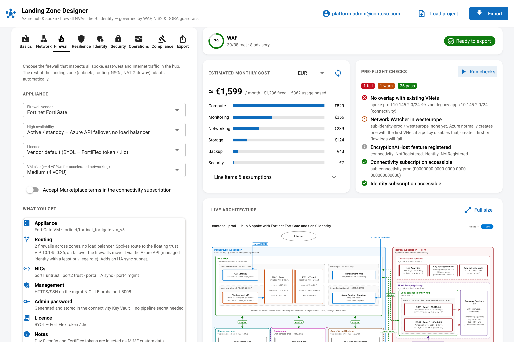

A simple front end for this landing zone. Users pick options from dropdowns, switches and presets. As they do, the designer:

- **draws the architecture live**: NVAs, DCs, regions, zones and IPs follow the choices,
- **validates every input** with the same rules as the Terraform variables (plus overlap and region checks Terraform can't express),
- **enforces the compliance baseline** for the frameworks you switch on (WAF always, plus NIS2 and DORA), locking the settings they require,
- **writes `terraform.tfvars`** for the Terraform in the repo root, and exports the diagram (editable draw.io), a compliance report and a re-openable project file,
- **lets you add workload spokes** with their own NSG rules,
- **estimates the monthly cost in euro** as you choose (bundled EUR baseline, or live prices from the Azure Retail Prices API),
- **signs in to Azure (optional)** to pick subscriptions and run **pre-flight checks** against your tenant,
- **prepares the deployment pipeline**: the bootstrap command and `environments/<env>.tfvars` for the approval-gated GitHub Actions workflow.

The complexity stays in the Terraform and the rules engine. The front end only asks for decisions.

## Run it

Create a virtual environment and install the requirements:

```bash
python -m venv .venv
```

```bash
.venv/bin/pip install -r gui/requirements.txt
```

Then start the app. It opens http://localhost:8080:

```bash
.venv/bin/python gui/app.py
```

To try sign-in and pre-flight without Azure access, start it with a fictional demo tenant:

```bash
LZDESIGNER_DEMO=1 .venv/bin/python gui/app.py
```

For a desktop window instead of a browser tab, install `pywebview` and run with `--native`:

```bash
.venv/bin/python gui/app.py --native
```

## Workflow

1. **Basics**: org prefix, environment, owner and cost centre (mandatory tags), primary region, and the five subscriptions: connectivity, identity, shared services, production and AVD.
2. **Network**: one base `/16`. Every address space is planned for you (or switch to manual). Add, rename or remove **spokes**, choose each spoke's **subscription** (connectivity, shared services, production or AVD), and give each one NSG rules. Choose NAT Gateway egress.
3. **Resilience**: Standard / High / Maximum, or fine-tune zones, NVA size and delete locks.
4. **Identity**: identity regions and DC zones, DC size and image, backup redundancy, tier-0 access and Key Vault firewall.
5. **Security**: NVA SSH key, Bastion SKU, encryption at host, DDoS plan.
6. **Operations**: alert recipients, log retention, flow logs, budget, CPU scaling signal.
7. **Compliance**: switch on NIS2 and/or DORA and review every control and its references.
8. **Export**: write `terraform.tfvars` (and `landingzone.json`) to the repo, or download them, plus the draw.io diagram and the compliance report. For the pipeline, fill in the GitHub repo and environment, write `environments/<env>.tfvars`, and copy the generated `scripts/bootstrap.sh` command.

Alongside the diagram:

- **Estimated monthly cost** breaks the total down by category and separates fixed from usage-based charges. Expand it for the line items and the usage assumptions. It shows euro by default. Press ⟳ to load live VM prices from `prices.azure.com` (EUR, or switch to USD or GBP). Offline, it shows the bundled EUR baseline.
- **Pre-flight checks** (after *Sign in to Azure*) use your Azure CLI session, a browser sign-in or a device code. Only Reader-level calls are made, and the designer stores no tokens. The checks are:
  - all five subscriptions exist and are enabled,
  - you hold deploy permissions (Owner, or Contributor + User Access Administrator),
  - no **overlap with existing VNets**,
  - a Network Watcher exists per region,
  - EncryptionAtHost is registered,
  - each VM size is available in the chosen zones,
  - there's enough **vCPU quota**.

  Click a result to jump to the tab that fixes it.

The header shows a score per framework and a **Ready to export** state once there are no input issues and no unmet required controls. *What needs attention* jumps to the tab to fix.

## Screenshots

### Start: what needs attention

A new design shows what's missing. Each item links to the tab where it's fixed, and export stays blocked until the list is empty.

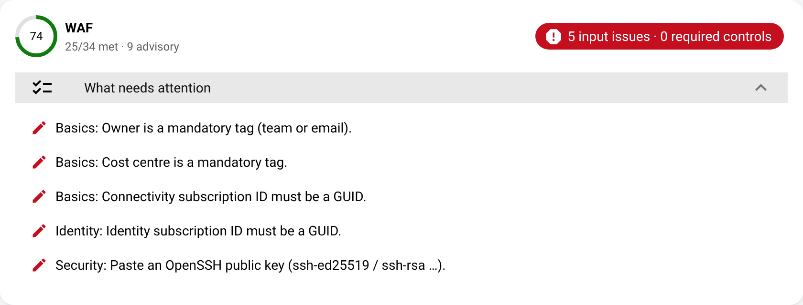

### Basics and network

Organisation, region and subscriptions on the left. One base `/16` plans every address space automatically, including the hub subnets and the ILB next hop, on the right.

<p>
  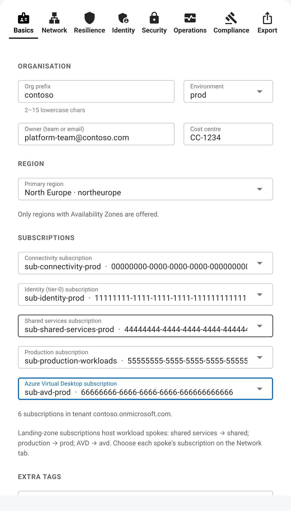
  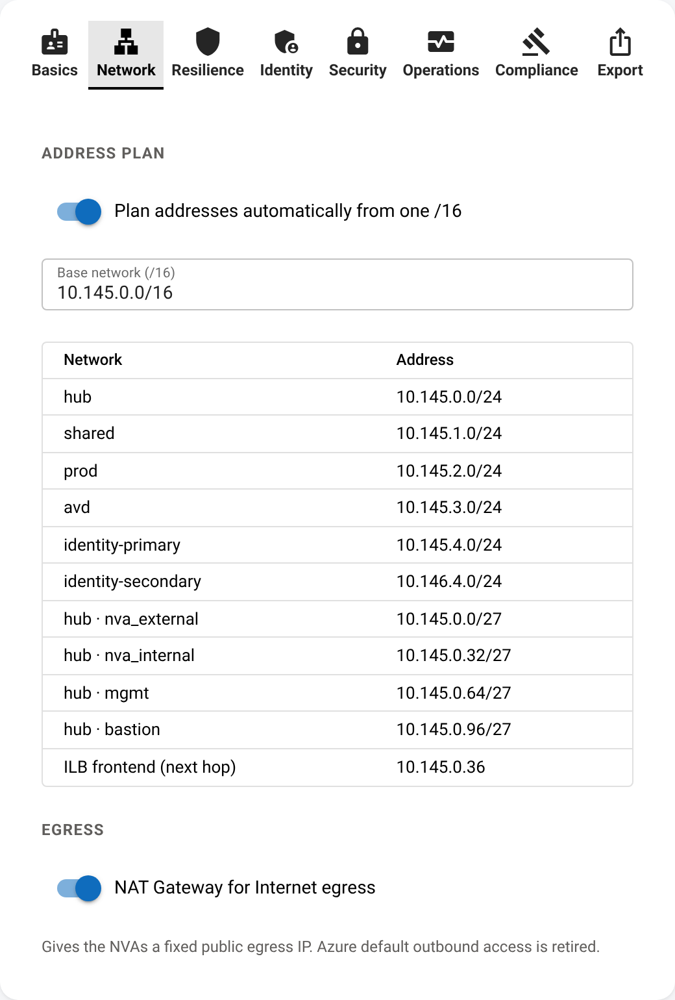
</p>

### Resilience and identity

Pick a resilience level instead of individual zones. Identity regions can be added or removed, and each one shows its address space and DC IPs.

<p>
  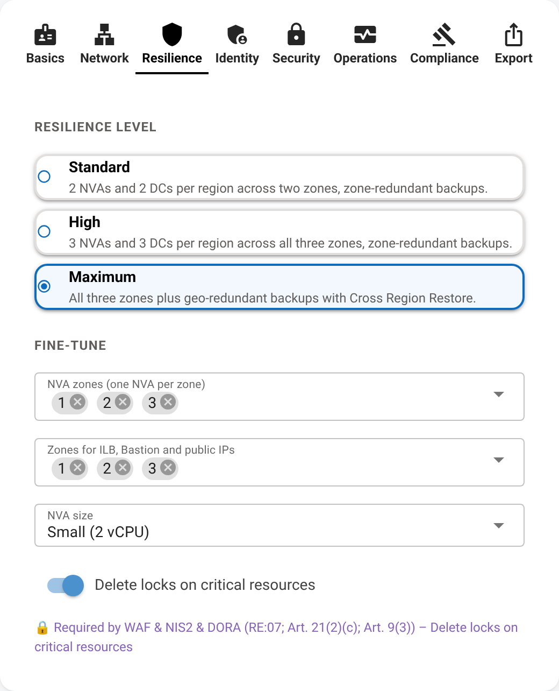
  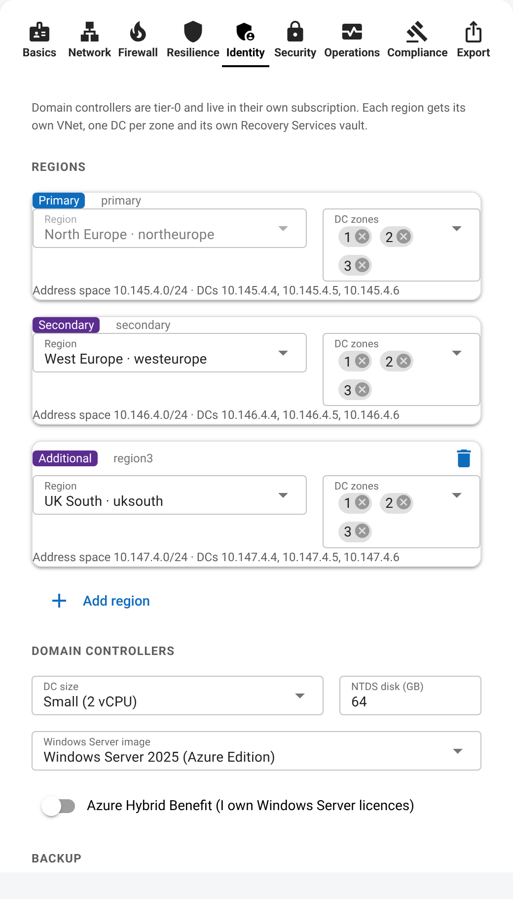
</p>

### Security and operations

Settings an enabled framework requires are applied and locked. The 🔒 note shows which framework and article require it.

<p>
  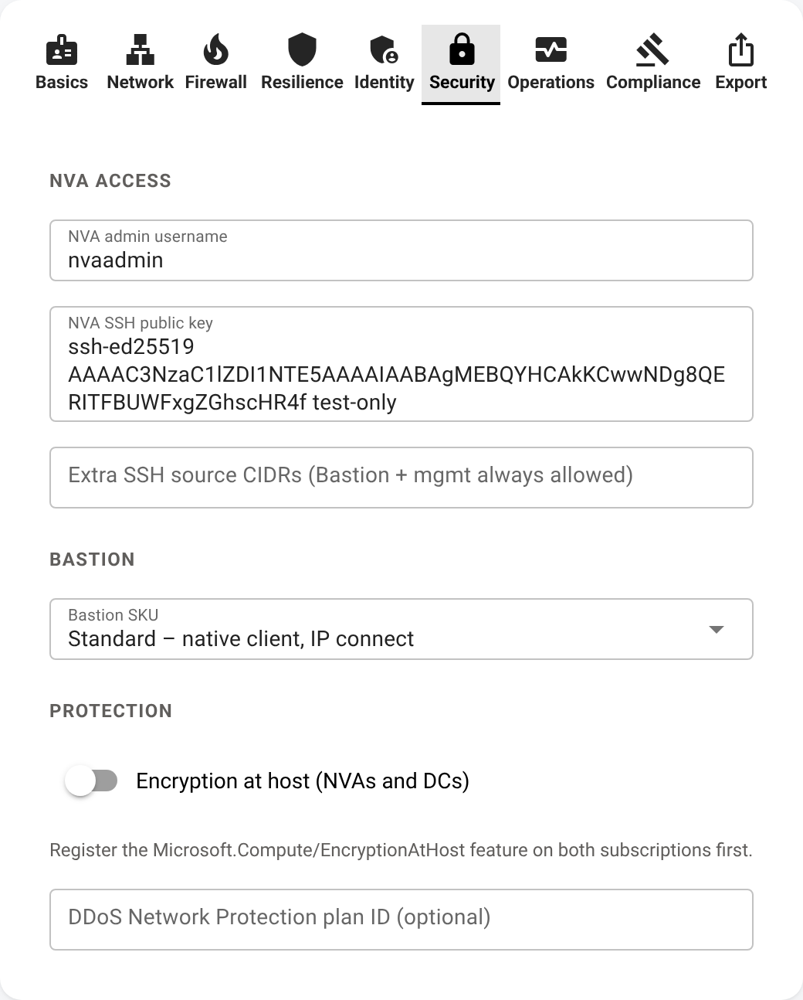
  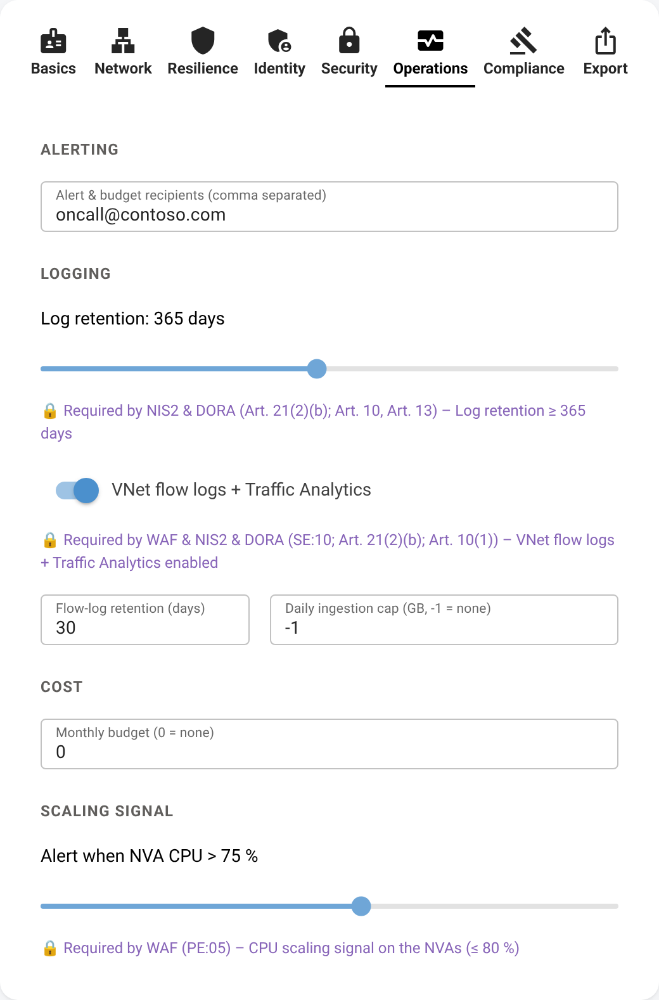
</p>

### Compliance and export

Switch NIS2 and DORA on to see every control with its WAF / NIS2 / DORA references. Export writes `terraform.tfvars` with a live preview, plus the diagram, compliance report and project file.

<p>
  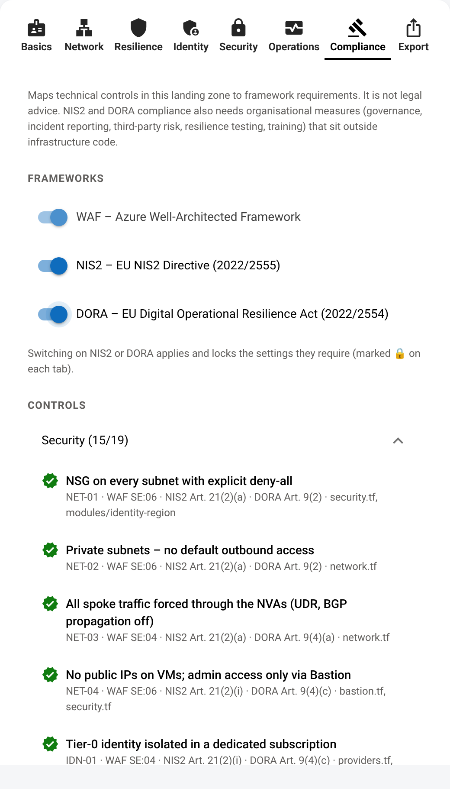
  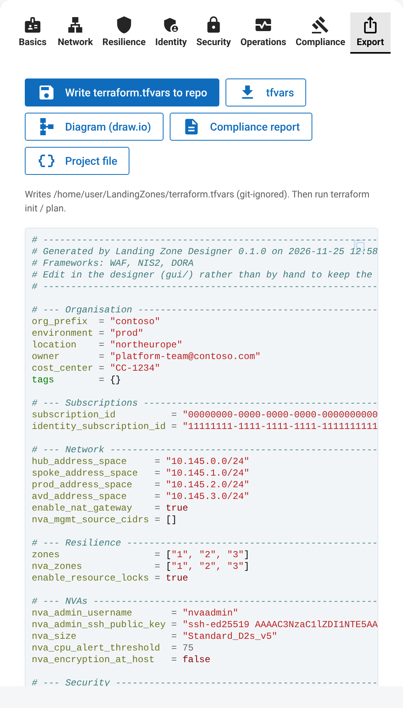
</p>

### Spokes, cost and pre-flight

Spokes are added on the Network tab, each with its own NSG rules. The cost estimate and pre-flight checks sit next to the diagram. Here, pre-flight found an existing VNet that overlaps the `prod` spoke.

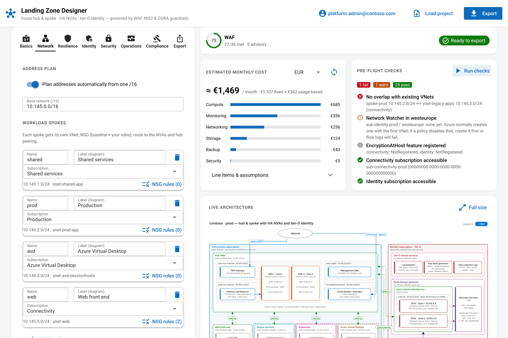

<p>
  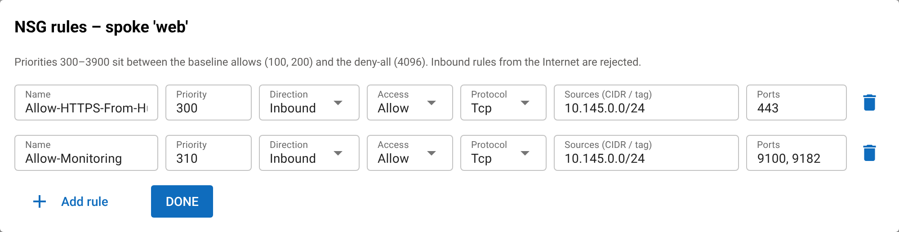
  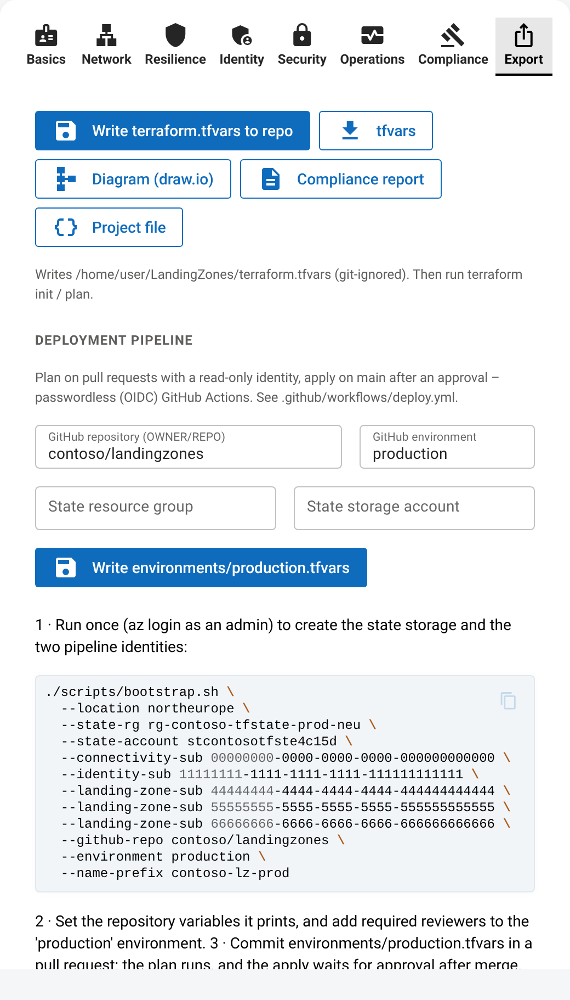
</p>

### Live architecture, full size

The diagram follows every choice. The first image shows the High preset with three NVAs and three DCs per region; the second adds a fourth spoke. *Download draw.io* saves an editable copy.

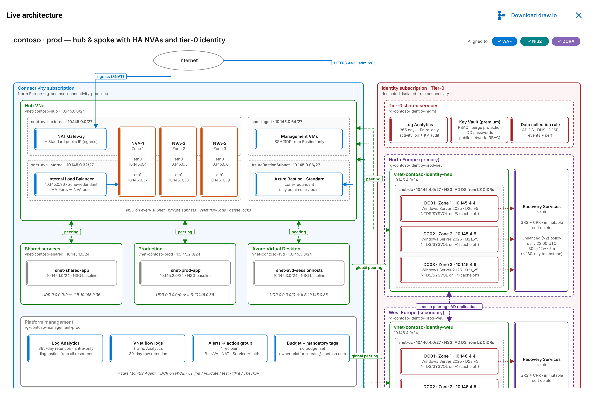

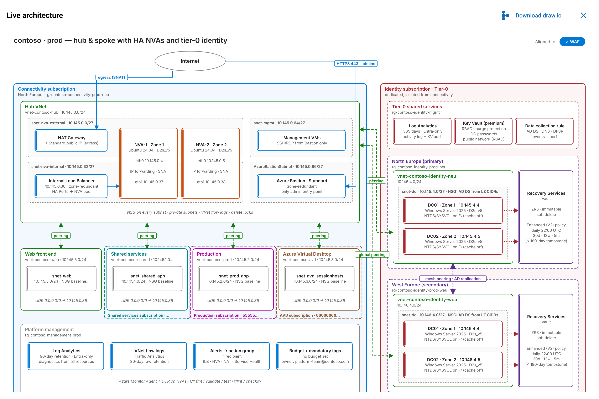

## How the guardrails work

`lzdesigner/compliance.py` holds a catalogue of controls. Each one maps a technical measure to:

- **WAF**: Well-Architected recommendation IDs (e.g. `SE:06`, `RE:09`, `OE:07`)
- **NIS2**: Directive (EU) 2022/2555, Art. 21(2)(a)–(j) and Art. 23
- **DORA**: Regulation (EU) 2022/2554, e.g. Art. 9 (protection), 10 (detection), 11 (response & recovery), 12 (backup), 17 (incident management)

There are two kinds of control:

- **Built-in** controls are always enforced by the Terraform code (e.g. NSGs everywhere, Trusted Launch, tier-0 subscription, immutable backups). They're listed as evidence.
- **Setting** controls depend on a choice. If an enabled framework *requires* one, it is applied automatically and locked (🔒, with the article shown). If the framework only *recommends* it, it's shown as advisory. If it needs a value only you can give (e.g. alert recipients), it blocks export until you provide it.

Examples: DORA locks geo-redundant backups with Cross Region Restore (Art. 12(3)) and 365-day log retention. NIS2 and DORA both require alert recipients (NIS2 Art. 23 early warning, DORA Art. 17).

> This maps technical controls in the landing zone to framework requirements. It is not legal advice. NIS2 and DORA also require organisational measures (governance, incident reporting, third-party risk, resilience testing, training) that sit outside infrastructure code.

## Structure

| Path | Purpose |
|---|---|
| `app.py` | NiceGUI front end (tabs, live diagram, status, export) |
| `lzdesigner/model.py` | Configuration model, mirrors the Terraform variables; address planning and presets |
| `lzdesigner/catalog.py` | Zone-capable regions, sizes, images, presets |
| `lzdesigner/validation.py` | Input validation (incl. SSH key decoding, CIDR overlap) |
| `lzdesigner/compliance.py` | WAF / NIS2 / DORA controls, scoring, enforcement, report |
| `lzdesigner/diagram.py` | Live SVG + editable draw.io export |
| `lzdesigner/tfvars.py` | `terraform.tfvars` renderer |
| `lzdesigner/pricing.py` | Cost estimate: bundled baseline + live Azure Retail Prices |
| `lzdesigner/azure.py` | Optional sign-in (CLI / browser / device code) and read-only pre-flight checks |
| `lzdesigner/demo.py` | Fictional tenant for demos and UI tests (`LZDESIGNER_DEMO=1`) |
| `tests/` | pytest suite: pre-flight against a fake tenant, pricing incl. a mocked Retail API, the bootstrap script in dry-run, and `test_terraform_integration.py`, which plans the generated tfvars with `terraform test` against mocked providers |

## Tests

```bash
pip install -r gui/requirements-dev.txt
```

```bash
python -m pytest gui/tests -q
```

The integration test needs an initialised Terraform working directory (`terraform init -backend=false`). It's skipped otherwise. CI runs it on every PR.

## Adding a Terraform variable

1. Add it to `variables.tf`.
2. Add the field to `LandingZoneConfig` and to a section in `tfvars.SECTIONS`.
3. Add a control on the relevant tab in `app.py`.
4. If it's governed, add or extend a control in `compliance.py`.

`tests/test_tfvars.py` fails if a Terraform variable isn't covered by the designer (or deliberately listed in `NOT_EXPOSED`).
