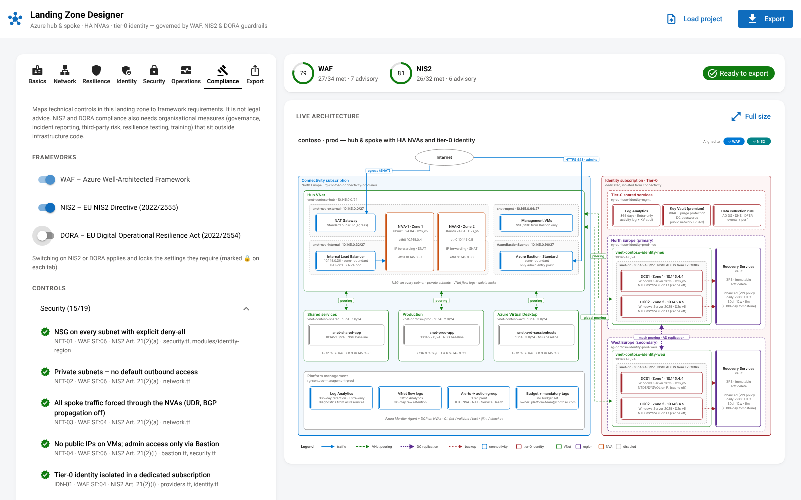

# Landing Zone Designer



A simple front end for this landing zone. Users pick options from dropdowns, switches and presets. As they do, the designer:

- **draws the architecture live**: NVAs, DCs, regions, zones and IPs follow the choices,
- **validates every input** with the same rules as the Terraform variables (plus overlap and region checks Terraform can't express),
- **enforces the compliance baseline** for the frameworks you switch on (WAF always, plus NIS2 and DORA), locking the settings they require,
- **writes `terraform.tfvars`** for the Terraform in the repo root, and exports the diagram (editable draw.io), a compliance report and a re-openable project file.

The complexity stays in the Terraform and the rules engine. The front end only asks for decisions.

## Run it

Create a virtual environment and install the requirements:

```bash
python -m venv .venv
```

```bash
.venv/bin/pip install -r gui/requirements.txt
```

Then start the app. It opens http://localhost:8080:

```bash
.venv/bin/python gui/app.py
```

For a desktop window instead of a browser tab, install `pywebview` and run with `--native`:

```bash
.venv/bin/python gui/app.py --native
```

## Workflow

1. **Basics**: org prefix, environment, owner and cost centre (mandatory tags), primary region, both subscription IDs.
2. **Network**: one base `/16`. Every address space is planned for you (or switch to manual). Choose NAT Gateway egress.
3. **Resilience**: Standard / High / Maximum, or fine-tune zones, NVA size and delete locks.
4. **Identity**: identity regions and DC zones, DC size and image, backup redundancy, tier-0 access and Key Vault firewall.
5. **Security**: NVA SSH key, Bastion SKU, encryption at host, DDoS plan.
6. **Operations**: alert recipients, log retention, flow logs, budget, CPU scaling signal.
7. **Compliance**: switch on NIS2 and/or DORA and review every control and its references.
8. **Export**: write `terraform.tfvars` (and `landingzone.json`) to the repo, or download them, plus the draw.io diagram and the compliance report. Then run `terraform init` and `terraform plan`.

The header shows a score per framework and a **Ready to export** state once there are no input issues and no unmet required controls. *What needs attention* jumps to the tab to fix.

## How the guardrails work

`lzdesigner/compliance.py` holds a catalogue of controls. Each one maps a technical measure to:

- **WAF**: Well-Architected recommendation IDs (e.g. `SE:06`, `RE:09`, `OE:07`)
- **NIS2**: Directive (EU) 2022/2555, Art. 21(2)(a)–(j) and Art. 23
- **DORA**: Regulation (EU) 2022/2554, e.g. Art. 9 (protection), 10 (detection), 11 (response & recovery), 12 (backup), 17 (incident management)

There are two kinds of control:

- **Built-in** controls are always enforced by the Terraform code (e.g. NSGs everywhere, Trusted Launch, tier-0 subscription, immutable backups). They're listed as evidence.
- **Setting** controls depend on a choice. If an enabled framework *requires* one, it is applied automatically and locked (🔒, with the article shown). If the framework only *recommends* it, it's shown as advisory. If it needs a value only you can give (e.g. alert recipients), it blocks export until you provide it.

Examples: DORA locks geo-redundant backups with Cross Region Restore (Art. 12(3)) and 365-day log retention. NIS2 and DORA both require alert recipients (NIS2 Art. 23 early warning, DORA Art. 17).

> This maps technical controls in the landing zone to framework requirements. It is not legal advice. NIS2 and DORA also require organisational measures (governance, incident reporting, third-party risk, resilience testing, training) that sit outside infrastructure code.

## Structure

| Path | Purpose |
|---|---|
| `app.py` | NiceGUI front end (tabs, live diagram, status, export) |
| `lzdesigner/model.py` | Configuration model, mirrors the Terraform variables; address planning and presets |
| `lzdesigner/catalog.py` | Zone-capable regions, sizes, images, presets |
| `lzdesigner/validation.py` | Input validation (incl. SSH key decoding, CIDR overlap) |
| `lzdesigner/compliance.py` | WAF / NIS2 / DORA controls, scoring, enforcement, report |
| `lzdesigner/diagram.py` | Live SVG + editable draw.io export |
| `lzdesigner/tfvars.py` | `terraform.tfvars` renderer |
| `tests/` | pytest suite. `test_terraform_integration.py` plans the generated tfvars with `terraform test` against mocked providers |

## Tests

```bash
pip install -r gui/requirements-dev.txt
```

```bash
python -m pytest gui/tests -q
```

The integration test needs an initialised Terraform working directory (`terraform init -backend=false`). It's skipped otherwise. CI runs it on every PR.

## Adding a Terraform variable

1. Add it to `variables.tf`.
2. Add the field to `LandingZoneConfig` and to a section in `tfvars.SECTIONS`.
3. Add a control on the relevant tab in `app.py`.
4. If it's governed, add or extend a control in `compliance.py`.

`tests/test_tfvars.py` fails if a Terraform variable isn't covered by the designer (or deliberately listed in `NOT_EXPOSED`).
