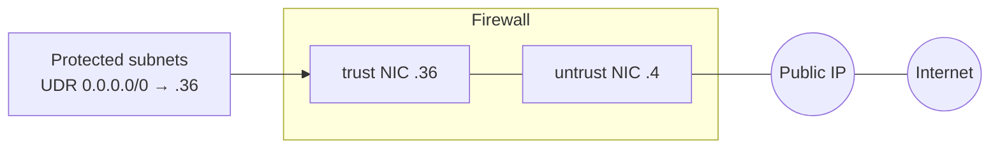
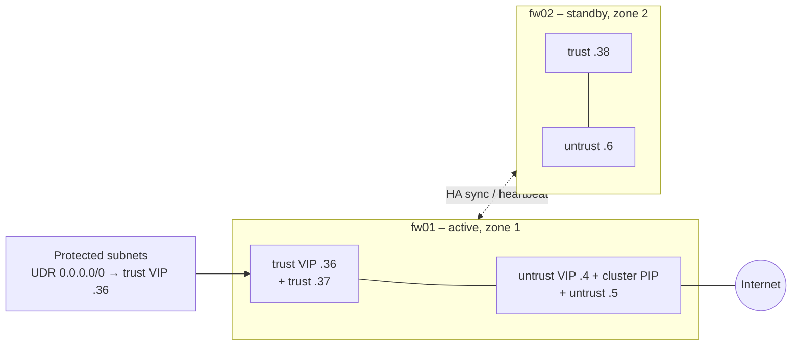
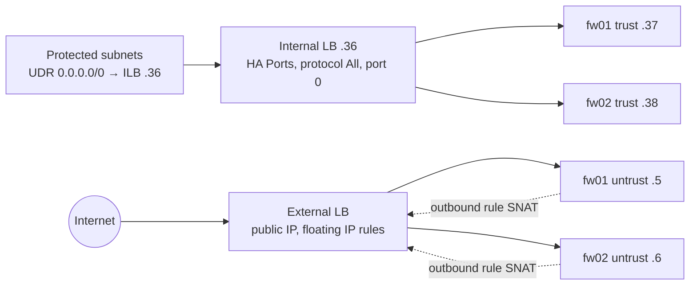

# Third-party firewall NVAs on Azure (multi-client)

Deploy FortiGate, SonicWall NSv, Palo Alto VM-Series or Netgate pfSense Plus into a client's Azure subscription in one of three HA patterns, from one composable codebase.

```
modules/
├── nva-firewall/              ← wrapper: the only module a client calls
│   ├── main.tf  variables.tf  outputs.tf  versions.tf
│   └── tests/                 ← terraform test: every vendor × HA mode (mocked)
├── network-ha-pattern/        ← layer 1: Azure plumbing per ha_mode
│   └── main.tf  variables.tf  outputs.tf  versions.tf
└── vendors/                   ← layer 2: one module per vendor, same interface
    ├── _nic/                  ← shared NIC definition (floating-IP aware)
    ├── fortigate/  (+ templates/ for the MIME day-0 config)
    ├── sonicwall/
    ├── paloalto/
    └── pfsense/
environments/
├── client-a-sonicwall-single/
├── client-b-pfsense-active-active/
└── client-c-fortinet-active-standby/
```

| Layer | Responsibility |
|---|---|
| `network-ha-pattern` | Hub VNet, subnets (`untrust`, `trust`, `mgmt`, conditional `hasync`), NSGs, public IPs, trust route table (UDR), load balancers (active-active), managed identity + custom failover role (active-standby), Availability Set fallback, management NAT Gateway |
| `vendors/<vendor>` | NIC layout and order, VM with Marketplace `plan`, optional `azurerm_marketplace_agreement`, day-0 bootstrap, LB pool membership, floating VIPs |
| `nva-firewall` | Creates the resource group and wires the two layers together for the chosen `vendor` and `ha_mode` |

Every vendor module takes the same standard inputs (`name_prefix`, `location`, `resource_group_name`, `ha_mode`, `network`, `vm_size`, `admin_username`, `admin_password`, `license_type`, `accept_marketplace_terms`, `marketplace_*`, `image_version`) and returns the same outputs (`instances`, `vm_ids`, `nic_order`, `interface_names`, `nic_settings`, `management_ips`, `marketplace`, `health_probe_port`). Only the vendor-specific bootstrap inputs differ.

---

## How traffic is routed in each HA mode

The hub `/24` is split into `/27`s: untrust `.0`, trust `.32`, mgmt `.64`, hasync `.96`. Azure reserves `.0–.3` of each subnet, so `.4` is the first usable address. **Associate `trust_route_table_id` with every protected subnet** (or point their UDRs at `next_hop_ip`).

### `single`: one firewall



- One VM. The untrust NIC holds the public IP, used for ingress (the firewall DNATs) and egress (the firewall SNATs).
- The trust route table sends `0.0.0.0/0` to the firewall's **trust IP** (`.36`).

### `active-standby`: two firewalls, Azure API failover (no load balancer)



- Two VMs in different zones, or an Availability Set where the region has no zones.
- **Floating addresses start on fw01:** a secondary IP config `ipconfig-vip` holds the trust VIP (`.36`) on the trust NIC, and the untrust VIP (`.4`) plus the **cluster public IP** on the untrust NIC.
- **Spokes route to the trust VIP**, never to a node, so a failover doesn't change any UDR.
- **On failover, the new active firewall moves `ipconfig-vip` and the cluster public IP onto its own NICs** through the Azure API. It authenticates with the cluster's **user-assigned managed identity**, which holds a custom role scoped to the client's resource group:
  - Required: `routeTables/routes/write`, `networkInterfaces/write`, `publicIPAddresses/write`.
  - Needed to move IP configs between NICs: `publicIPAddresses/join`, `subnets/join`, `networkSecurityGroups/join`.
  - The matching read actions.
- Terraform ignores IP-config drift on the untrust/trust NICs in this mode. Otherwise the next `apply` would move the VIP back to fw01.
- **HA sync** runs over a dedicated `hasync` NIC and subnet (FortiGate `port3`, Palo Alto HA2 `ethernet1/3`, SonicWall `X2`).

### `active-active`: two or more firewalls behind Azure Standard Load Balancers



- **Internal Standard LB:** frontend `.36` in trust, with an **HA Ports** rule (`protocol = "All"`, ports `0`). It carries east-west traffic and egress from the spokes. The trust UDR points `0.0.0.0/0` at the ILB frontend.
- **External Standard LB:** one public IP. `inbound_rules` become LB rules with floating IP enabled, so each firewall sees the public IP as the destination and DNATs it. An **outbound rule** gives the firewalls SNAT for egress.
- **Symmetry:** HA Ports hashes both directions of a flow to the same firewall. For traffic that enters from the Internet, the firewalls should SNAT towards the inside. pfSense: configure **outbound NAT on WAN** on every instance.
- **Health probes** come from `168.63.129.16` on the vendor's probe port (FortiGate 8008, the others 443). Allow that source in the firewall policy on trust and untrust.

---

## Vendor matrix

| | FortiGate | SonicWall NSv | Palo Alto VM-Series | pfSense Plus |
|---|---|---|---|---|
| **NIC order** (first = primary) | `untrust` (port1), `trust` (port2), `hasync` (port3, A-S only), `mgmt` (port4, or port3 without HA) | `trust` (X0, management), `untrust` (X1), `hasync` (X2, A-S only) | `mgmt` (NIC0), `untrust` (eth1/1), `trust` (eth1/2), `hasync` (eth1/3 HA2, A-S only). With `mgmt_interface_swap`, `untrust` comes first. | `untrust` = WAN → `hn0`, `trust` = LAN → `hn1` |
| **HA modes** | single · A-S (FGCP + Azure SDN connector) · A-A | single · A-S (stateful HA over X2 + managed identity) · A-A | single · A-S (HA1/HA2 + managed identity) · A-A | single · A-A. **A-S blocked**: CARP needs multicast. |
| **Day-0** | MIME multipart `custom_data`: CLI config (interfaces, routes, probe responder, HA, SDN connector) and a licence part (`LICENSE-TOKEN:` FortiFlex token or `.lic`), one per instance | Optional `custom_data`; finish in the NSv wizard or NSM | `custom_data`: `storage-account=…;access-key=…;file-share=…;share-directory=…;mgmt-interface-swap=enable` | Optional `custom_data`; restore `config.xml` after first boot |
| **Default admin** | `fgtadmin` | `nsvadmin` | `panadmin` | `pfsenseadmin` (`admin`/`root` are rejected) |
| **Publisher / offer** | `fortinet` / `fortinet_fortigate-vm_v5` | `sonicwall-inc` / `sonicwall-nsz-azure` | `paloaltonetworks` / `vmseries-flex` | `netgate` / `pfsense-plus-public-cloud-fw-vpn-router` |
| **Default SKUs** | byol `fortinet_fg-vm_g2` · payg `fortinet_fg-vm_payg_2023_g2` | byol `snwl-nsz-byol` · payg `snwl-nsz-payg` | `byol` · `bundle1` · `bundle2` · `bundle3` | `pfsense-plus-public-tac-lite` |

All vendors get:

- `ip_forwarding_enabled` and `accelerated_networking_enabled` on the `untrust` and `trust` NICs.
- A VM size of **4 or more vCPUs**, enforced (default `Standard_D4s_v5`).
- A VM `plan` block that matches the image.
- An optional `accept_marketplace_terms` toggle.

> **Check the Marketplace names before the first deployment.** Publishers rename offers and SKUs, especially across new generations (SonicWall NSv and pfSense Plus in particular). The defaults above couldn't be checked against a live tenant when this was written. Override them with `marketplace_offer` / `marketplace_sku` if they differ. See the next section.

---

## Looking up current Marketplace images

```bash
az vm image list --publisher fortinet --offer fortinet_fortigate-vm_v5 --all -o table
```

```bash
az vm image list --publisher sonicwall-inc --all -o table
```

```bash
az vm image list --publisher paloaltonetworks --offer vmseries-flex --all -o table
```

```bash
az vm image list --publisher netgate --all -o table
```

Offers and SKUs available in a specific region:

```bash
az vm image list-offers --location northeurope --publisher netgate -o table
```

```bash
az vm image list-skus --location northeurope --publisher netgate --offer pfsense-plus-public-cloud-fw-vpn-router -o table
```

Check, or accept, the legal terms for a plan in the client's subscription (the `plan` is the SKU):

```bash
az vm image terms show --publisher fortinet --offer fortinet_fortigate-vm_v5 --plan fortinet_fg-vm_g2
```

```bash
az vm image terms accept --publisher fortinet --offer fortinet_fortigate-vm_v5 --plan fortinet_fg-vm_g2
```

`accept_marketplace_terms = true` does the same from Terraform. If the terms were already accepted (by hand or by another deployment), the resource fails with *already exists*. Either set the toggle to `false`, or import the agreement:

```bash
terraform import 'module.firewall.module.fortigate[0].azurerm_marketplace_agreement.this[0]' /subscriptions/<sub>/providers/Microsoft.MarketplaceOrdering/agreements/fortinet/offers/fortinet_fortigate-vm_v5/plans/fortinet_fg-vm_g2
```

---

## Onboarding a new client

1. **Copy the closest example:**

   ```bash
   cp -r environments/client-c-fortinet-active-standby environments/client-d-paloalto-active-active
   ```

2. **Edit `main.tf`** in the new folder: `client_name`, `location`, `address_space` (unique per client if you'll ever peer them), `vendor`, `ha_mode`, `vm_size`, `license_type`, `mgmt_source_cidrs`, `inbound_rules`, and any vendor block:
   - **FortiGate:** `fortigate_license_tokens`, `fortigate_internal_cidrs`, `fortigate_extra_config`.
   - **Palo Alto:** `paloalto_bootstrap`, `paloalto_bootstrap_access_key`, `paloalto_mgmt_interface_swap`.
   - **SonicWall / pfSense:** `custom_data`.

3. **Set `subscription_id`** in `terraform.tfvars`, and uncomment the `backend "azurerm"` block in `versions.tf` with a client-specific `key`.

4. **Provide secrets** through the environment or your pipeline's secret store. Never commit them.

   ```bash
   export TF_VAR_admin_password='…'
   ```

5. **Look up the image** (previous section) and decide whether Terraform should accept the terms (`accept_marketplace_terms`).

6. **Deploy:**

   ```bash
   terraform init
   ```

   ```bash
   terraform plan -out tfplan
   ```

   ```bash
   terraform apply tfplan
   ```

7. **Route the spokes through the firewall:**
   - Associate the `trust_route_table_id` output with every protected subnet. For subnets in the same subscription, use the module's `protected_subnet_ids` input.
   - Peer spoke VNets with the firewall hub.

8. **Finish vendor configuration:**
   - security policies and NAT;
   - allow LB probes from `168.63.129.16`;
   - for active-standby, confirm the HA cluster forms and test a failover (stop the active VM, then check the VIP and cluster public IP moved).

Run the offline checks for a client folder before every change:

```bash
terraform init -backend=false && terraform test
```

---

## Security notes

- **Management:** reachable only from `mgmt_source_cidrs` (the module rejects `0.0.0.0/0`). Management egress goes through a NAT Gateway by default, so there are no public IPs on management NICs unless `management_egress = "public_ip"`.
- **Failover permissions:** the custom role is scoped to the client's firewall resource group. Spoke UDRs in other resource groups or subscriptions aren't writable by the firewalls, and they don't need to be, because those UDRs target the VIP.
- **Palo Alto bootstrap access key:** it ends up in VM custom data. Rotate it after the firewalls have bootstrapped.
- **Licence tokens and passwords** are `sensitive`, but they're stored in Terraform state. Keep state in an access-controlled, encrypted backend.

## Tests

`modules/nva-firewall/tests` covers:

- NIC order per vendor and mode, including Palo Alto's interface swap;
- IP forwarding and accelerated networking per NIC;
- UDR next hop per mode, and LB vs cluster resources;
- the Availability Set fallback;
- the FortiGate MIME config with per-instance licence tokens;
- Palo Alto bootstrap custom data and its validation;
- the pfSense active-standby precondition;
- reserved admin names and the 4-vCPU minimum.

Each client folder has a mocked plan test. CI runs all of them.
